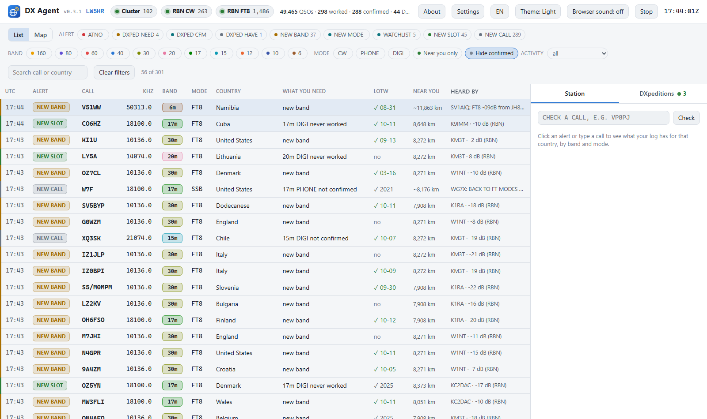
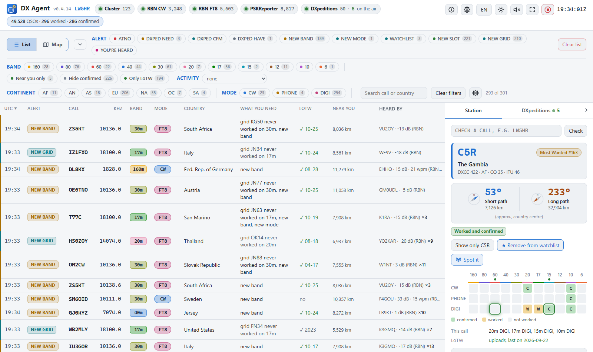
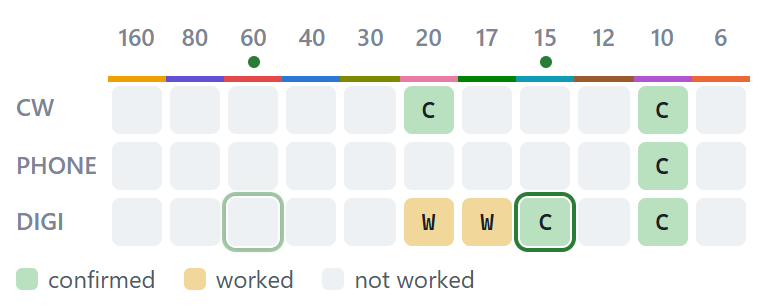
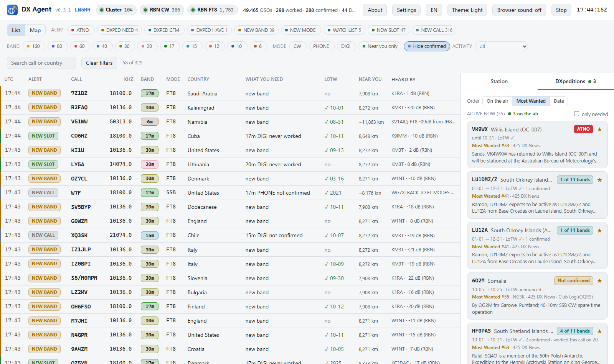
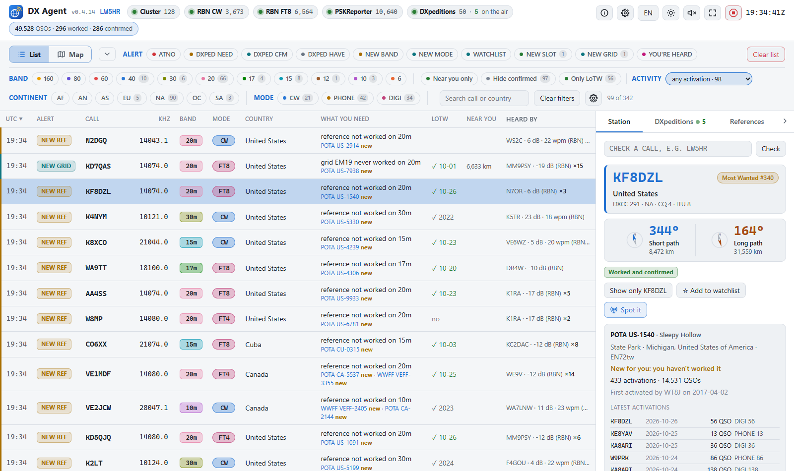
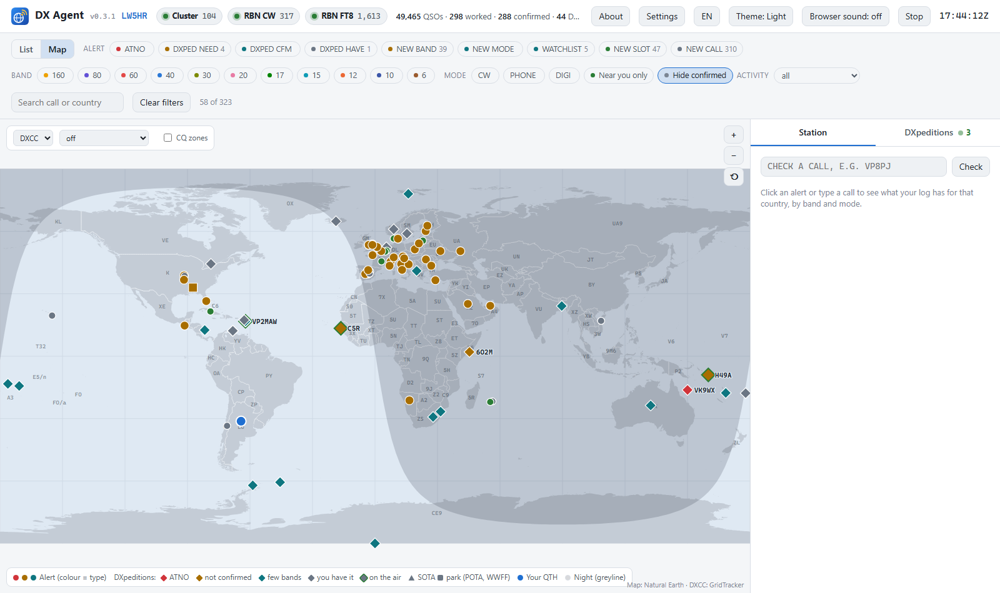
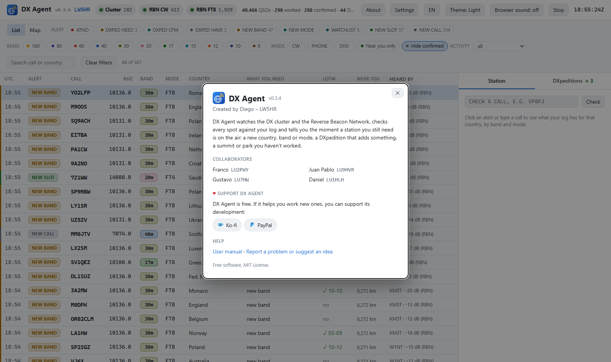

# DX Agent — User manual

*Version 0.4.10 · Made by Diego – LW5HR · Collaborators: Franco – LU2PWY, Juan Pablo – LU9HVR, Gustavo – LU7HW, Daniel – LU1HLH, Javi – LU5FF · [Versión en castellano](MANUAL.es.md)*

DX Agent watches the DX cluster and the Reverse Beacon Network (RBN), checks every station
spotted against your log, and tells you when one you still need is on the air: a new country,
a new band or mode, a DXpedition that adds something, or a station on your watchlist. It runs
on your PC and you use it from your web browser.

Contents:

1. [What you need](#1-what-you-need)
2. [Install and open it](#2-install-and-open-it)
3. [First setup](#3-first-setup)
4. [The screen](#4-the-screen)
5. [Alerts](#5-alerts)
6. [Tune the radio and pass the call to your logger](#6-tune-the-radio-and-pass-the-call-to-your-logger)
7. [Let DX Agent see your QSOs at once](#7-let-dx-agent-see-your-qsos-at-once)
8. [DXpeditions](#8-dxpeditions)
9. [Activations: POTA, SOTA, IOTA...](#9-activations-pota-sota-iota)
10. [The map](#10-the-map)
11. [CQ DX Marathon](#11-cq-dx-marathon)
12. [LoTW](#12-lotw)
13. [Updating to a new version](#13-updating-to-a-new-version)
14. [Common problems](#14-common-problems)
15. [Help and contact](#15-help-and-contact)

---

## 1. What you need

- **Windows 10 or 11, Linux (x86_64) or a Mac (Apple Silicon or Intel).** The package brings
  everything it needs (Python included): nothing to install.
- **An internet connection**, for the spots and the DXpedition, country and LoTW lists.
- **Your log**, in one of two ways:
  - an **ADIF** file your logging program writes: Log4OM's backups, for example, or an ADIF
    export from any other logger;
  - or your **LoTW** account, if you have no ADIF file: DX Agent downloads every QSO you
    uploaded there;
  - or nothing yet, if you're starting from scratch: DX Agent creates a new log for you
    (section 3).
- Optional: your **LoTW password**, so DX Agent knows what you have confirmed even when your
  logger isn't synced with LoTW.

## 2. Install and open it

1. Download the latest `dx-agent-<version>-windows.zip` from the
   [Releases](https://github.com/ddimunzio/dx-agent-download/releases/latest) page.
2. Unzip it wherever you like, for example in `Documents`. Your settings and data aren't kept
   there but in a folder of your own that every version uses (section 13): the program's folder
   can be replaced or deleted.
3. Double-click **start-dx-agent.bat**. The dashboard opens in your browser at
   **http://localhost:8073**.

If Windows shows a security warning the first time (the file came from the internet), choose
the option to run it (**Run**, or **More info → Run anyway**). To avoid it: before unzipping,
right-click the zip → **Properties** → tick **Unblock** → OK.

**How it runs:** without a window. While it runs, double-clicking start-dx-agent.bat again just
opens the dashboard (a newer version you open stops the old one and takes its place). To close it, use the **Stop** button at the top right of the dashboard. To
see what it is doing, use **start-dx-agent-console.bat**, which runs it in a console window.

You can bookmark the dashboard: `http://localhost:8073`. Only your PC can open it; other
computers on your network can't.

### On Linux

1. Download the latest `dx-agent-<version>-linux-x86_64.tar.gz` from the same
   [Releases](https://github.com/ddimunzio/dx-agent-download/releases/latest) page.
2. Unpack it into a folder of yours and start it:

   ```sh
   tar -xzf dx-agent-<version>-linux-x86_64.tar.gz
   cd dx-agent
   ./start-dx-agent.sh
   ```

   The dashboard opens in your browser at **http://localhost:8073**, as on Windows.
   `./start-dx-agent-console.sh` runs it in the terminal, to see what it does.

### On a Mac

1. Download the latest `dx-agent-<version>-macos.tar.gz` from the same
   [Releases](https://github.com/ddimunzio/dx-agent-download/releases/latest) page. It works on
   every Mac, Apple Silicon (M1, M2...) or Intel.
2. Double-click it to unpack it, and move the `dx-agent` folder wherever you like, for example
   Documents.
3. Double-click **start-dx-agent.command** in it. The dashboard opens in your browser at
   **http://localhost:8073**, as on Windows.

The first time, macOS says it can't open it, because it isn't signed by Apple. Open **System
Settings → Privacy & Security**, scroll down to the message about start-dx-agent.command, click
**Open Anyway** and confirm; then double-click it again. From then on a double-click is enough.
Or, in Terminal:

```sh
cd ~/Documents/dx-agent
xattr -dr com.apple.quarantine .
./start-dx-agent.command
```

Pop-ups go to the Mac's Notification Center (macOS may ask for permission the first time).

Log4OM, N1MM, DXLog.net and OmniRig are Windows programs: reading Log4OM's database and tuning
through them only work on Windows. The rest is the same on Linux and on a Mac (the UDP QSOs from
WSJT-X, tuning through flrig, Hamlib or TCI... included).

## 3. First setup

The first time, the dashboard shows a yellow bar, because it doesn't know where your log is
yet. Click **Settings** (top right) and fill in:

1. **Station**
   - **Callsign:** yours. It is used to log in to the cluster and the RBN.
   - **Your log:** an ADIF file, **LoTW only (no ADIF file)**, or **Start from scratch (a new
     log)**: DX Agent creates an empty log, `data\<CALL>.adi` in your DX Agent folder, and adds to it the QSOs your
     programs send it as you log them (WSJT-X, N1MM... see section 7). When you start using a
     logger, import that file there and choose ADIF file.
   - **ADIF log:** click **Browse…** and pick the file. If you pick a dated Log4OM backup
     (`W1ABC_20261016_124613_backup.adi`), DX Agent turns it into `…/W1ABC_*_backup.adi`, so the
     newest backup is always used. **Test** shows which file it found and how many QSOs it has.
   - **Grid square:** yours (FN31, GF05pr...). Empty = taken from your log. It is used for the
     map, the beam heading and "near you".
   - **Your other callsigns** (optional; a contest call, say): **+ Add a callsign**, the call
     and its log: an ADIF file, or Log4OM's database itself (the `.SQLite` file, nothing to
     export). Alerts, DXCC and WAZ count all your callsigns together; the picker in the header
     can show just one.
2. **LoTW** (optional): your LoTW username and password, then **Test login**. The password is
   stored encrypted for your Windows user (on Linux and a Mac, readable only by you), never as
   plain text.
3. **Alerts:** which alert types you want, on which bands and modes. The defaults are a good
   start.
4. **Radio (Tune button):** the program that controls your radio (see section 6). If you don't
   want DX Agent to move your radio, leave it off.
5. Click **Save and apply**. No restart needed: within seconds it reads your log again (the top
   says "Reading your log…") and connects to the spot sources.

If something is wrong (an invalid callsign, no band picked...), a list appears in red next to
the button, and nothing is saved until it's fixed.

The dashboard follows your browser's language; the **EN/ES/PT** button in the header switches it:
English, Spanish or Portuguese (Brazil).

## 4. The screen



**Header:** your callsign (with several, a picker: **All**, or one alone to see what that one
still needs); one pill per spot source (green = connected, amber = connecting,
red = down); the **DXpeditions** pill ("48 · 6 on the air": how many are within their dates and
how many were spotted in the last 15 minutes; a click opens their tab); your log's totals, in a
blue pill; icon buttons (hover one to see what it does): **About** ⓘ, **Settings** ⚙,
**EN/ES/PT**, **Theme** (light / dark / auto), **Sound** (a beep for the important alerts, off by
default) and **Stop**, in red; the UTC clock. **About** tells what DX Agent is, who made it and its
collaborators, and has the links to support it, to the website, to this manual and to report a
problem.

**Filters**, above the list, in three rows:

- buttons for **alert type** (only the types turned on in Settings), **band** and **mode** (none
  ticked = everything shows). Each option says how many stations it would show, with the other
  filters as they are: with 20 m picked, the modes say how many on 20 m;
- **Continent** (AF, AN, AS, EU, NA, OC, SA): keeps the stations
  from the continents picked, to stay with where your antenna points. Your own call spotted
  always shows;
- **Activity:** only POTA, SOTA, IOTA... activations (section 9);
- **Near you only:** only stations heard by someone near you. It only hides the others: they still alert. The
  setting **Only alert when heard near you** (Settings → Alerts) is different: with it, a station heard only far away
  never alerts, and where few receivers are near you the list stays almost empty (the dashboard then says how many
  didn't alert). Usually the filter is what you want;
- **Hide confirmed:** hides what you already have confirmed on that band and mode;
- **Only LoTW:** only stations that uploaded to LoTW in the last 12 months, and DXpeditions that
  announced LoTW;
- a **search** box for a callsign or country;
- **Clear filters** shows everything again. Your browser remembers the filters.
- **⚙** (next to Clear filters, or Settings → **Filters above the list**): which of Continent, Near you only, Hide
  confirmed, Only LoTW and Activity show. A hidden one is turned off. The alert types, bands and modes are the ones you
  alert on (Settings → Alerts).

**The alert list:** one row per alert, newest on top, coloured by type. Columns: UTC time,
alert type, callsign, frequency, band, mode, country, **what you need**, LoTW, **near you** and
who heard it. New rows flash. When the station is spotted again on the same band and mode, its
row updates (time, frequency, who heard it, ×N): it shows where the station is now. Rows fade 10
and 30 minutes after the station's last spot there.

**Clear list** (in red, top right): empties the list, after asking. Whatever is still on the air
alerts again at its next spot.

**Sort by a column:** click a column's header to sort the list by it: by frequency, by band, by
mode (CW, phone and digital together), by country... **Alert** and **What you need** put the
most wanted first, **LoTW** the latest uploads first. Click again for the other way round, and a
third time for newest on top again. An arrow shows the order. New alerts go into their place, and
the browser remembers the order.

**On the right, the Station tab:** clicking a row (on the call or on the frequency) opens the
station:

- a card with the call, its country, zones and **Most Wanted** rank on Club Log;
- both **beam headings**, large, each with its compass and distance: the short path in blue,
  the long path in orange;
- the band × mode grid of its country: green **C** = confirmed, amber **W** = worked, grey =
  missing. **Hover a C or W** for the QSOs that made it (call, date, mode, ✓ when confirmed):
  you see at once whether that 20 m QSO was this DXpedition or another station years ago;
- **where it's on the air now**, in that same grid: a **green ring** on each band and mode
  where it was spotted in the last 15 minutes, and a dot ● over the band. The cell of the
  **latest spot blinks**: that's where the station is now; the others keep a steady ring, and
  the blinking moves when it's spotted on another band. A DXpedition on several bands at
  once (S9R, say) shows a ring on each, with the latest one blinking. Hover a ringed cell
  for when, where and who spotted it; **click it to tune there** (with a radio set up, section 6). With no spot for 15 minutes, the ring goes. A ring on
  an empty cell: it's on the air on a band you need;
- whether you worked that exact call, its LoTW status and, for a DXpedition, its details;
- with the CQ DX Marathon on, what it adds to the Marathon (section 11);
- for a station on a **POTA park or SOTA summit**, a card with what pota.app or SOTA say about
  it: name, type and place, how many activations and QSOs, who activated it first, its latest
  activations, whether **you** worked it and on which bands (or "New for you"), and links;
- **Who hears it**, the receivers nearest to you first, and **Check PSKReporter (FT8/FT4)** (or,
  with PSKReporter live, the receivers as they report it: section 5);
- **Show only** this call, **☆ Add to watchlist**, **Spot it** (below), its **Latest spots**, and
  links to QRZ.com, HamQTH and DXWatch. **Latest spots** and **Who hears it** are pills: hover one
  to see what it lists.

**Spot it** (the antenna button) posts a DX spot of the station on the DX cluster DX Agent is
logged in to, as your callsign: `DX 14025.0 3Y0K up 2`, say. It opens a small form with the
frequency of the row you clicked (you can change it) and a comment (up to 30 plain characters),
and asks you to confirm. Then it says whether the cluster took it: **posted** when the cluster
sends it back, **sent** when it doesn't (W3LPL, for example), or what the cluster answered if it
refused it. At most one spot every 30 seconds; with the cluster off or down the button is grey.





**The DXpeditions tab:** see section 8. **The Marathon tab:** see section 11. Clicking a country
on the map shows that country in the Station tab (section 10).

**List / Map:** to the left of the filters, switches between the list and the map (section 10).

## 5. Alerts

| On the dashboard | What it means | By default |
|------------------|---------------|------------|
| **ATNO** | A country you never worked | on, with a Windows pop-up |
| **DXPED NEED** | An active DXpedition that adds a country, band or mode | on |
| **DXPED CFM** | A DXpedition from a country worked but not confirmed on that band or mode | on |
| **DXPED HAVE** | A DXpedition you already have confirmed on that band and mode (grey) | on |
| **NEW BAND** | Country worked, but not on this band | on |
| **NEW MODE** | Country worked, but not in this mode (CW, phone, digital) | on |
| **WATCHLIST** | A call on your watchlist | on |
| **NEW SLOT** | Country not worked on this band and mode combination | off |
| **NEW CALL** | This exact call isn't in your log (lots of alerts) | off |
| **MARATHON** | A country or CQ zone you haven't worked yet in the CQ DX Marathon (section 11) | on, while you follow the Marathon |
| **YOU'RE HEARD** | Your own call spotted, on any band and mode: the row is highlighted in pink and says how far away and in which country the skimmer is ("heard 8,912 km away, in United States"). Click it for every receiver that heard you, on the map too | on |

- **What you need** says exactly what the station adds: "new band", "17m DIGI never worked",
  "entity not confirmed", or "have it".
- **Confirmed** means LoTW or paper QSL, as in the ARRL's DXCC (eQSL doesn't count).
- **LoTW** says whether the station uploads to LoTW (and its last upload), whether the
  DXpedition announced LoTW, or "no LoTW".
- **Near you:** green **● 732 km · 7 dB** = heard by a receiver within your "near" radius (1,500
  km by default); in grey, the distance to the nearest receiver; **—** = nobody reported it in
  the last 15 minutes.
- The same alert isn't repeated for 15 minutes (change it in Settings).
- Settings → Alerts also has **Keep only the latest row of each station** (same call,
  frequency and mode) and **Take out of the list after** N minutes without a spot (0 = never):
  both off by default.
- The list keeps the last 500 alerts. When it's full, NEW CALL ones leave first; the others
  stay at least an hour.
- When you work the station, its alerts in the list change by themselves: a NEW SLOT you worked
  isn't one any more (nor under that filter), a DXpedition becomes DXPED CFM or DXPED HAVE, and an
  alert that adds nothing now shows as **WORKED**, in grey.
- **Windows pop-ups** are shown for ATNO only by default; in Settings you can turn them on for
  more types. Clicking one opens the dashboard at that station.

**Watchlist:** calls you always want to hear about, even if they add nothing. Wildcards work,
for example `VP8*`. Edit it in Settings or with the ☆ in the Station tab. **Ignore** does the
opposite: those calls never alert. In the filters, **WATCHLIST** with another type shows only the
calls you follow that are also that type: **WATCHLIST** + **NEW SLOT** is your watchlist on a band
and mode you still need.

**PSKReporter live:** in Settings → Spot sources → **PSKReporter** you can pick **When you ask**
(one query every 5 minutes, with the Station tab's button; the default) or **Live (MQTT)**:
PSKReporter's reports as they arrive, with no limit, for the station open in the Station tab and
the digital alerts in the list. Their receivers count for "near you" and the map without a button,
and a **PSKReporter** pill in the header shows the connection. It needs your grid square.

## 6. Tune the radio and pass the call to your logger

With a radio set up (Settings → **Radio (Tune button)**), clicking an alert's **frequency** has
your program move the radio there, and the station opens on the right. The Station tab also
has a **Tune** button. A message at the top right says whether it worked.

| Program | What to do in the program | Mode too? |
|---------|---------------------------|-----------|
| **Log4OM 2** | Settings → Software integration → Connections → turn on **Remote control** (port 2241) | yes, when Log4OM uses OmniRig |
| **N1MM Logger+** | nothing | no |
| **DXLog.net** | Options → Configure network: add port `13064` to the **UDP broadcast listener**; Options → Broadcast → **Receive broadcasts** | no |
| **OmniRig** | pick OmniRig's rig 1 or 2 in DX Agent | yes |
| **Hamlib (rigctld)**, **flrig**, **DXLab Commander** | have the program running | yes |
| **TCI** (AetherSDR for FlexRadio, ExpertSDR, Thetis) | AetherSDR: Settings → **Autostart TCI with AetherSDR** (or **Enable** in its TCI applet, port 50001) | yes |

- **With Log4OM, the callsign is filled in too**, in its QSO window, ready to log. If you typed a
  call there yourself, Log4OM keeps yours.
- **With Log4OM, the mode** changes through OmniRig, the program Log4OM uses to control the
  radio: with **Also set the mode** ticked, DX Agent uses the OmniRig rig that is on-line and
  Log4OM follows it. If Log4OM controls your radio another way, only the frequency changes.
- **Radios that need their data mode for FT8** (an IC-9100 in USB-D, for example): put the
  radio in USB-D once. From then on, clicking FT8/FT4 spots moves only the frequency and leaves
  USB-D on. A phone spot switches to USB or LSB, and the next FT8 spot stays in USB: put USB-D
  back by hand. The same goes for CW: a radio in CW or CW-R keeps it.
- **FlexRadio with AetherSDR (TCI), in testing:** Tune moves the active slice and sets the mode
  (CW, USB/LSB, RTTY, DIGU for FT8). With **Show the alerts on the radio's panadapter (TCI)** (on
  by default), each station of the list shows on AetherSDR's panadapter in its colour, with its
  headline and country; it moves when the station changes frequency and leaves when it's no
  longer spotted. A click on one tunes there and opens it in DX Agent's Station tab. A **TCI**
  pill in the header shows the connection. Tested with AetherSDR's demo radio; if you use it with
  a Flex, tell us how it went in [issue #10](https://github.com/ddimunzio/dx-agent-download/issues/10).
- **WSJT-X:** tick **Also send the call to WSJT-X** in DX Agent, and in WSJT-X tick Settings →
  Reporting → **Accept UDP requests**. Clicking an FT8/FT4 spot puts the radio on the FT8/FT4
  frequency, fills in **DX Call** and **DX Grid**, and moves the audio to the station's
  frequency; you click **Enable Tx**.

## 7. Let DX Agent see your QSOs at once

DX Agent reads your log file at start and whenever it changes. But many loggers write that file
only now and then (Log4OM makes a backup every so often), and meanwhile a station you just
worked keeps alerting. To avoid that, your logger can tell DX Agent each QSO as you save it:

- **Log4OM 2: nothing to do.** DX Agent reads the new QSOs straight from Log4OM's database,
  every 10 seconds.
- **Other loggers, over UDP:** in your logger, add the destination `127.0.0.1`, port `12065`,
  next to the ones you already have:

| Logger | Where |
|--------|-------|
| **N1MM Logger+** | Config → Configure Ports… → **Broadcast Data**: tick **Contacts** and add `127.0.0.1:12065` |
| **DXLog.net** | Options → Configure network: QSO broadcast `127.0.0.1:12065`; Options → Broadcast: QSO and **Use N1MM QSO format** |
| **HRD Logbook** | Tools → Configure → QSO Forwarding → **UDP Send**: `127.0.0.1`, port `12065` (not tested with HRD yet) |
| **WSJT-X / JTDX** | usually not needed: your logger gets their QSOs and passes them on to DX Agent |

- **Loggers without UDP** (DXKeeper, Logger32, N3FJP...): if they write an ADIF file as you log
  (or export one automatically), add that file in Settings as a second log file, under the
  main one.

When a new QSO comes in, the alerts already listed update by themselves and stop saying "new
band" once you've worked it. QSOs received over UDP are kept until your log has them: closing
DX Agent before that doesn't lose them.

## 8. DXpeditions



The **DXpeditions** tab shows the active ones and those starting in the next 30 days,
gathered from NG3K, 425 DX News and Club Log.

- Each card says what it adds: **ATNO**, **Not confirmed**, or how many bands you have (for
  example "3 of 10 bands").
- **ON THE AIR** (green frame) = spotted in the last 15 minutes, with its frequency (click to
  tune).
- **Order:** **On the air** (the ones transmitting first), **Most Wanted** (the most wanted
  country on Club Log first) or **Date**.
- **only needed** hides the ones you have on most bands (those on the air still show).
- **When one ends:** once its announced end date has passed, DX Agent reads the sources again
  before taking it off the list. If one of them extended it, it stays with the new date.
- When you open a DXpedition that uploads its log to Club Log, DX Agent looks for your call in
  their log: it shows the bands and modes you're in, and warns you if a QSO of yours isn't in
  theirs.

## 9. Activations: POTA, SOTA, IOTA...



The **Activity** menu (next to the mode filters) shows only activations: **POTA, SOTA, IOTA,
WWFF, BOTA, COTA** (castles), **LOTA** (lighthouses), **TOTA, ROTA, JOTA, YOTA** and **EME**, with
how many stations are on in the last hour. Its first option, **none**, turns the Activity filter
off.

- With an activity picked, the list also shows its spots that made no alert (**SPOT** rows),
  such as a park in a country you already have. One row per station, band and mode (the latest
  spot, **×N** how many), grey if it adds nothing, in colour if it still adds something.
- Each row shows the reference (`POTA US-5584`, `SOTA W7A/MN-001`...). Hover over it for the
  park's or summit's name, and for summits their altitude and points.
- **NEW REF:** with an activity picked, a summit, park, island or castle you haven't worked
  **on that band** is marked new, even if you have the country confirmed. DX Agent knows what
  you worked from the references in your log and from your QSOs with activators it saw on the
  air (since you started using it).
- On the map, with an activity picked, summits are mountains and parks are pine trees, at their
  real location: red if you haven't worked that reference, amber worked, green confirmed. With no
  activity picked they are a dot like any other station.
- **The References tab** (it shows while an activity is picked): every summit, park, island and
  castle you worked (POTA, SOTA, WWFF, IOTA, WCA), program by program: how many worked, confirmed
  and confirmed by paper QSL, and each one with its name and place, the bands, **C** confirmed /
  **W** worked and your latest QSO. You can see all of them, the confirmed ones, those with a
  **QSL** (paper card) or the unconfirmed ones. Click one for **your QSOs with it** (call, date,
  band, mode, ✓ confirmed in LoTW, ✓ QSL by card) and, for POTA or SOTA, its card. *Confirmed* means the QSO is confirmed in LoTW or by QSL;
  each program's own credit is on its site (pota.app, sotadata, wwff.co).

## 10. The map



Click **Map** (next to **List**). The filters work the same as in the list.

- **Dots:** alerts, coloured by type. **Diamonds:** active DXpeditions (green frame = on the
  air). **Mountains and pine trees:** summits and parks. **Blue dot:** your QTH.
- A dot fades 10 minutes after the station's last spot and more after 30: a faded dot is where
  it was, not where it is. Hover it to see how long ago.
- The shaded area is where it's night (its edge is the grey line).
- Picking a station draws the path from your QTH, with heading and distance, and the receivers
  that heard it.
- **Click a country** (or near a small island): the Station tab shows it as a lookup does: its
  card, the beam headings to its centre, its status and grid.
- Mouse wheel or **+ / −** to zoom, drag to move, **⟲** for the whole world. Dragging east or
  west goes round the world (past the Pacific, the map continues on the other side).
- **DXCC** (top left) paints each entity by your award standing: green = confirmed, amber =
  worked, red = missing. Pick Mixed, Phone, CW, Digital, one band, Satellite or the Challenge.
- **WAZ** paints the 40 CQ zones the same way, with its variants (by mode, by band, 5BWAZ...).
- With one band (or mode) picked in the filters above, DXCC and WAZ paint that band ("12 m
  (filter)"), unless you picked one in their own menus.
- **References** (next to DXCC / WAZ): your POTA parks and SOTA summits, green confirmed, amber
  worked. Click one for its card and your QSOs with it, in the Station tab.
- **DXpeditions** (next to DXCC / WAZ / References): which diamonds show: those **on the air**
  (the default), those **needed**, **all** the active ones, or **no**. The station open in the
  Station tab always shows.
- Several DXpeditions at the same place (four at Koror, Palau, say) sit on a small ring around
  it, so each one can be clicked.

## 11. CQ DX Marathon

The [CQ DX Marathon](https://dxmarathon.com) scores one point for each country and one for each
CQ zone you work: in the year (January 1 to December 31) or in the **Sprint**, ten days in
October. To follow it: Settings → **CQ DX Marathon** → **Track the countries and CQ zones I
work**; pick the year or the Sprint (with its dates), the modes your entry counts (all, one, or
**Classic**: CW and SSB) and, if you have several callsigns, which ones count (up to 2, as the
rules allow).

- **The Marathon tab** (next to DXpeditions) shows the period, your score (countries + zones),
  the 40 CQ zones (green = worked) and the countries: **Worked**, with the QSO that counts (click
  it to open the station), or **Missing**, with a search box. The tab's number is your score.
- **MARATHON alert** (purple): a station that adds a country or a zone, even in a country you
  have confirmed for DXCC. Country and zone alerts can be turned off separately. The MARATHON
  filter and the tab only show while you follow the Marathon.
- **Countries:** the CQ DX Countries List: the DXCC entities plus Sicily (IT9), African Italy
  (IG9/IH9), Shetland (GM/s), European Turkey (TA1), Bear Island (JW/b) and 4U1VIC.
- **Zones:** the QSO's zone in your log, else the call's. A US, Canadian or Russian station can
  be in another zone than its call says.
- DX Agent doesn't submit your entry: at the end, upload your ADIF at
  [entry.dxmarathon.com](https://entry.dxmarathon.com).

## 12. LoTW

- **Who uploads to LoTW:** DX Agent downloads the ARRL's public list every day and shows, in
  each alert, whether the station uploads to LoTW. No password needed.
- **Your confirmations:** with your LoTW username and password (Settings → LoTW → **Download my
  LoTW confirmations**), DX Agent downloads your confirmed QSLs every 12 hours, so "confirmed"
  stays current even if your logger isn't synced. The first download can take a few minutes; if
  LoTW is busy or doesn't answer, DX Agent tries again by itself every 10 minutes and carries on
  where it stopped.
- **LoTW as your log:** with no ADIF file, choose Settings → Station → **Your log** → **LoTW
  only (no ADIF file)**. Only what you uploaded to LoTW counts.
- **Several callsigns:** one LoTW account with every callsign's certificate is enough: each
  callsign takes its own confirmations.

## 13. Updating to a new version

A pill next to the version number tells you when a new one is out, with a link to its page (DX
Agent asks GitHub every hour; nothing of yours is sent, nothing is installed). To update:

1. Download the new package and unpack it wherever you like: in another folder or over the old
   one.
2. Open it as usual with **start-dx-agent.bat** (Linux: `./start-dx-agent.sh`; Mac:
   **start-dx-agent.command**). If the old version is running, it stops by itself and the new one
   takes its place.
3. The old version's folder can be deleted.

**Your settings and data** (`config.toml` and the `data` folder: the alert history, the saved
LoTW password, the log if you started from scratch) aren't in the program's folder but in a
folder of your own that every version uses:

| System | Folder |
|---|---|
| Windows | `%APPDATA%\DX Agent` |
| Mac | `~/Library/Application Support/DX Agent` |
| Linux | `~/.config/dx-agent` |

**Settings** shows the exact path. Up to 0.4.4 they were kept in the program's folder: the first
time you open a newer version, it copies your settings and data from there (or from the older
version beside it) and says so on the dashboard. The old version stays as it was.

## 14. Common problems

| What happens | What to do |
|--------------|------------|
| Yellow bar "No ADIF file found" | Settings → **Browse…** for your log file, **Test** until it finds it, then **Save and apply** |
| The dashboard doesn't open | Open `http://localhost:8073` yourself. If it says the port is taken, another program (or another copy of DX Agent) is using it |
| "Lost connection to DX Agent" | DX Agent closed: open it again with start-dx-agent.bat (Mac: start-dx-agent.command; Linux: start-dx-agent.sh); the page reconnects by itself |
| A station I just worked keeps alerting | See section 7. Without your logger telling DX Agent, it updates when your logger writes its ADIF file |
| Slow to start with a very big log | The first time it reads the whole log (250,000 QSOs: about 15 seconds); then it keeps a cache in `data\cache` (in your DX Agent folder) and starts in a second, unless the log changed |
| Too many alerts | In Settings → Alerts keep only **ATNO** and **DXpedition**, or untick bands you don't operate |
| Very few cluster alerts | Normal: the cluster sends a few spots a minute, and the RBN usually reports the same station first |
| No Windows pop-ups | Settings → **Show pop-ups**, and in Windows: Settings → System → Notifications (including "Windows PowerShell") |
| Mac: "start-dx-agent.command cannot be opened" | It isn't signed by Apple: System Settings → Privacy & Security → **Open Anyway** (section 2) |
| Tune doesn't move the radio | Check your program's remote control (section 6) and that it's running; the message at the top right says what failed |
| AetherSDR: the **TCI** pill is red or amber | In AetherSDR turn on Settings → **Autostart TCI with AetherSDR** (or **Enable** in its TCI applet) and check the port is 50001 |
| A settings change made things worse | `config.toml.bak`, in your DX Agent folder (section 13), has the previous settings: copy it over `config.toml` and open DX Agent again |
| "saved password could not be read" | The LoTW password was saved by another Windows user or PC: type it again in Settings |
| My logger says a band and mode is confirmed, DX Agent says not (amber **W**) | Most likely the only confirmation is an **eQSL**. DX Agent follows the ARRL's DXCC rules: only LoTW or a paper QSL count, eQSL doesn't (for WAZ, which accepts eQSL, it does count). Many loggers count eQSL as confirmed. For the ARRL, that band and mode still needs a LoTW or paper confirmation |

What DX Agent does is written to `data\dx-agent.log`, in your DX Agent folder (on Windows,
`%APPDATA%\DX Agent\data\dx-agent.log`). If you report a problem, that file helps a lot.

## 15. Help and contact



- **Report a problem or suggest an improvement:** in this repository's
  [Issues](https://github.com/ddimunzio/dx-agent-download/issues). Say what you did, what you
  expected and what happened, and if you can, attach `data\dx-agent.log` (it doesn't contain
  your password).
- **Full technical documentation** (every setting in the configuration file, how it works
  inside): [docs/DOCUMENTATION.md](docs/DOCUMENTATION.md), and in the zip.
- **Support DX Agent:** [Ko-fi](https://ko-fi.com/lw5hr) · [PayPal](https://paypal.me/diegodimunzio1) · from Argentina, [Cafecito](https://cafecito.app/lw5hr) (also in the dashboard's **About** window)
- **Made by** Diego – LW5HR, with Franco – LU2PWY, Juan Pablo – LU9HVR, Gustavo – LU7HW, Daniel – LU1HLH, Javi – LU5FF.
- **License:** free software, [MIT](LICENSE): anyone can use, copy and share it.

73, Diego – LW5HR
