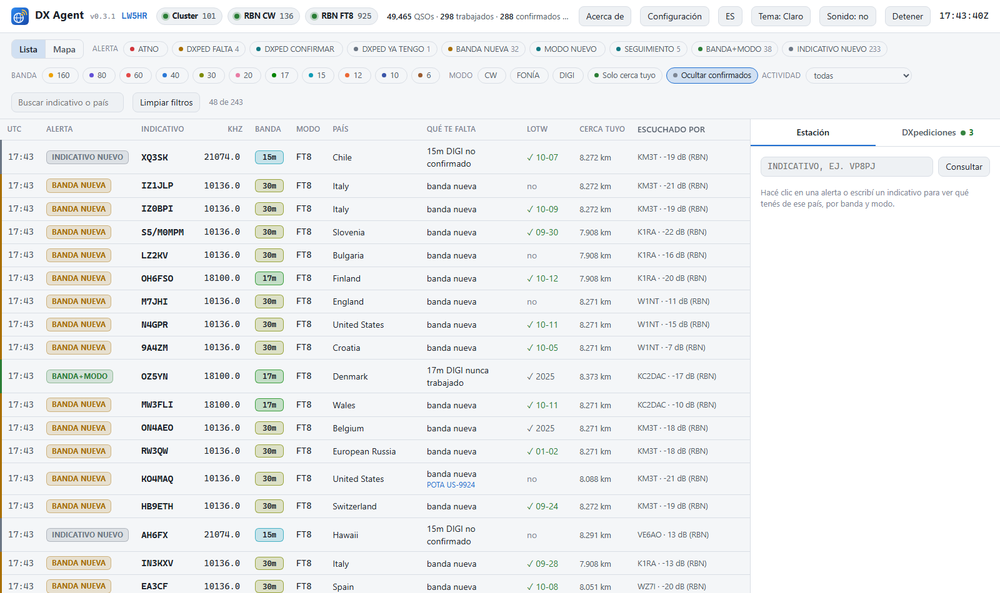
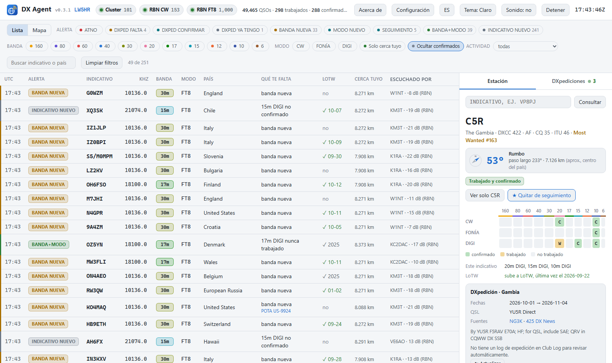
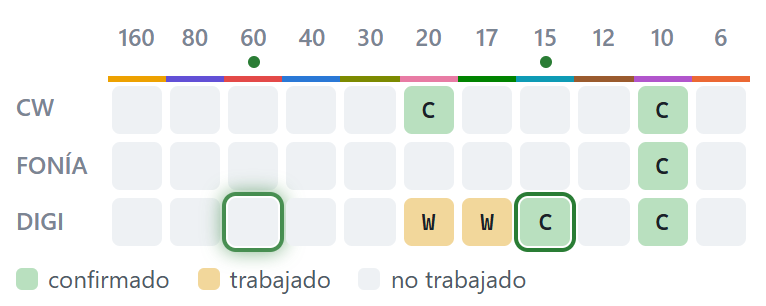
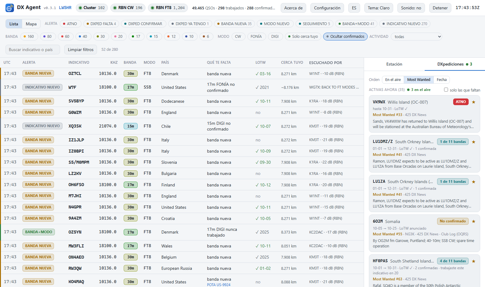
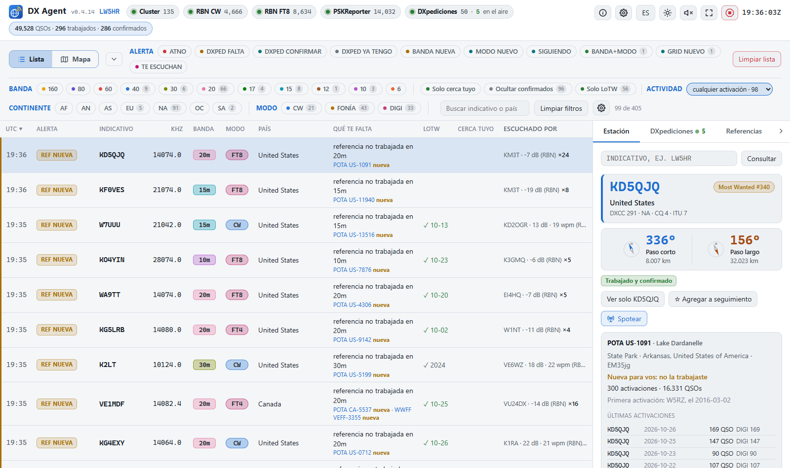
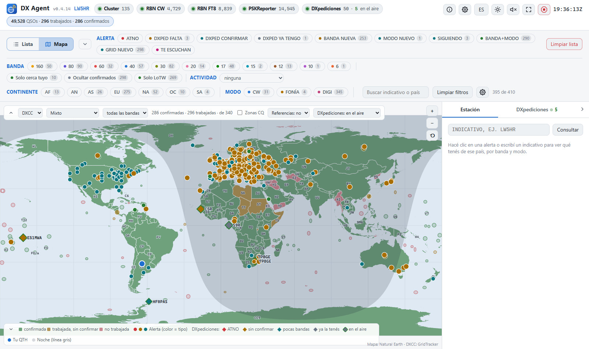
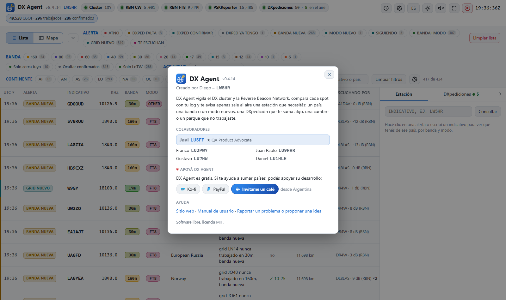

# DX Agent — Manual de usuario

*Versión 0.4.0 · Creado por Diego – LW5HR · Colaboradores: Franco – LU2PWY, Juan Pablo – LU9HVR, Gustavo – LU7HW, Daniel – LU1HLH · [English version](MANUAL.en.md)*

DX Agent vigila el DX cluster y la Reverse Beacon Network (RBN), compara cada estación
reportada con tu log y te avisa cuando sale al aire una que todavía necesitás: un país nuevo,
una banda o un modo nuevos, una DXpedición que te suma algo, o una estación de tu lista de
seguimiento. Corre en tu PC y se maneja desde el navegador.

Contenido:

1. [Qué necesitás](#1-qué-necesitás)
2. [Instalarlo y abrirlo](#2-instalarlo-y-abrirlo)
3. [La primera configuración](#3-la-primera-configuración)
4. [La pantalla](#4-la-pantalla)
5. [Las alertas](#5-las-alertas)
6. [Sintonizar la radio y pasar el indicativo al logger](#6-sintonizar-la-radio-y-pasar-el-indicativo-al-logger)
7. [Que DX Agent vea tus QSOs al instante](#7-que-dx-agent-vea-tus-qsos-al-instante)
8. [DXpediciones](#8-dxpediciones)
9. [Activaciones: POTA, SOTA, IOTA...](#9-activaciones-pota-sota-iota)
10. [El mapa](#10-el-mapa)
11. [CQ DX Marathon](#11-cq-dx-marathon)
12. [LoTW](#12-lotw)
13. [Actualizar a una versión nueva](#13-actualizar-a-una-versión-nueva)
14. [Problemas frecuentes](#14-problemas-frecuentes)
15. [Ayuda y contacto](#15-ayuda-y-contacto)

---

## 1. Qué necesitás

- **Windows 10 u 11, o Linux (x86_64).** El paquete ya trae todo lo necesario (incluido
  Python): no hay que instalar nada.
- **Conexión a internet**, para recibir los spots y bajar las listas de DXpediciones,
  países y LoTW.
- **Tu log**, de una de estas dos formas:
  - un archivo **ADIF** que escriba tu programa de log: por ejemplo los backups de Log4OM,
    o una exportación ADIF de cualquier otro programa;
  - o tu cuenta de **LoTW**, si no tenés un archivo ADIF: DX Agent baja de ahí todos los QSOs
    que subiste;
  - o nada todavía, si estás empezando de cero: DX Agent te crea un log nuevo (sección 3).
- Opcional: tu **contraseña de LoTW**, para que DX Agent sepa qué tenés confirmado aunque tu
  programa de log no esté sincronizado.

## 2. Instalarlo y abrirlo

1. Bajá el último `dx-agent-<versión>-windows.zip` de la página
   [Releases](https://github.com/ddimunzio/dx-agent-download/releases/latest).
2. Descomprimilo en una carpeta tuya, por ejemplo `Documentos\dx-agent` (no en
   `Archivos de programa`: DX Agent guarda su configuración y sus datos dentro de su
   carpeta).
3. Hacé doble clic en **start-dx-agent.bat**. El panel se abre en el navegador, en
   **http://localhost:8073**.

Si Windows muestra un aviso de seguridad la primera vez (el archivo viene de internet),
elegí la opción para ejecutarlo (**Ejecutar**, o **Más información → Ejecutar de todas
formas**). Para que no aparezca: antes de descomprimir, clic derecho en el zip →
**Propiedades** → marcar **Desbloquear** → Aceptar.

**Cómo corre:** sin ventana. Mientras está abierto, volver a hacer doble clic en
start-dx-agent.bat solo abre el panel otra vez. Para cerrarlo, botón **Detener** arriba a
la derecha del panel. Si querés ver lo que va haciendo, usá **start-dx-agent-console.bat**,
que lo abre en una ventana de consola.

Podés guardar el panel en los favoritos del navegador: `http://localhost:8073`. Solo se
puede abrir desde tu PC; otras computadoras de la red no lo ven.

### En Linux

1. Bajá el último `dx-agent-<versión>-linux-x86_64.tar.gz` de la misma página
   [Releases](https://github.com/ddimunzio/dx-agent-download/releases/latest).
2. Descomprimilo en una carpeta tuya y abrilo:

   ```sh
   tar -xzf dx-agent-<versión>-linux-x86_64.tar.gz
   cd dx-agent
   ./start-dx-agent.sh
   ```

   El panel se abre en el navegador, en **http://localhost:8073**, igual que en Windows.
   `./start-dx-agent-console.sh` lo corre en la terminal, para ver lo que va haciendo.

Log4OM y OmniRig son programas de Windows: leer la base de Log4OM y sintonizar por OmniRig
funcionan solo en Windows. Todo lo demás es igual (incluidos los QSOs por UDP de N1MM, DXLog,
WSJT-X...).

## 3. La primera configuración

La primera vez el panel muestra una franja amarilla, porque todavía no sabe dónde está tu
log. Hacé clic en **Configuración** (arriba a la derecha) y completá:

1. **Estación**
   - **Indicativo:** el tuyo. Se usa para entrar al cluster y a la RBN.
   - **Tu log:** *Archivo ADIF*, *Solo LoTW* o *Empezar de cero (log nuevo)*: DX Agent crea un
     log vacío, `data\<INDICATIVO>.adi`, y le agrega los QSOs que tus programas le mandan al
     loguearlos (WSJT-X, N1MM... ver la sección 7). Cuando empieces a usar un programa de log,
     importá ese archivo ahí y elegí Archivo ADIF.
   - **Ruta del log:** hacé clic en **Buscar…** y elegí el archivo. Si elegís un backup de
     Log4OM con fecha (`LW1ABC_20261016_124613_backup.adi`), DX Agent lo convierte en
     `…/LW1ABC_*_backup.adi`, así usa siempre el más nuevo. **Probar** muestra qué archivo
     encontró y cuántos QSOs tiene.
   - **Grid locator:** tu cuadrícula (GF05, FN31pr...). Vacío = la toma de tu log. Se usa para
     el mapa, el rumbo de antena y "cerca tuyo".
   - **Tus otros indicativos** (opcional; por ejemplo uno de concurso): **+ Agregar un
     indicativo**, el indicativo y su log: un archivo ADIF o directamente la base de datos de
     Log4OM (el archivo `.SQLite`, sin exportar nada). Las alertas, el DXCC y el WAZ suman todos
     tus indicativos juntos; el selector del encabezado permite ver uno solo.
2. **LoTW** (opcional): tu usuario y contraseña de LoTW, **Probar ingreso**. La contraseña
   queda guardada cifrada para tu usuario de Windows, nunca en texto.
3. **Alertas:** qué tipos de alerta querés, en qué bandas y modos. Para empezar, los valores
   de fábrica andan bien.
4. **Radio (botón Sintonizar):** el programa que maneja tu radio (ver sección 6). Si no
   querés que DX Agent mueva la radio, dejalo en *Desactivado*.
5. Hacé clic en **Guardar y aplicar**. No hace falta reiniciar: en unos segundos vuelve a
   leer el log (arriba dice "Leyendo tu log…") y se conecta a las fuentes de spots.

Si algo está mal (un indicativo inválido, ninguna banda elegida...), aparece una lista en
rojo junto al botón y no se guarda nada hasta corregirlo.

El panel aparece en el idioma del navegador; el botón **ES/EN** del encabezado lo cambia.

## 4. La pantalla



**Encabezado:** tu indicativo (con varios, un selector: **Todos** o uno solo, para ver qué le
falta a ese); una pastilla por cada fuente de spots (verde = conectada,
ámbar = conectando, rojo = caída); los totales de tu log; los botones **Configuración**,
**Acerca de**, **ES/EN**, **Tema** (claro / oscuro / automático), **Sonido** (un pitido para las
alertas importantes, apagado de fábrica) y **Detener**; el reloj UTC. **Acerca de** cuenta qué es
DX Agent, quién lo hizo y sus colaboradores, y tiene los links para apoyarlo, a este manual y
para reportar un problema.

**Filtros**, arriba de la lista:

- botones por **tipo de alerta**, **banda** y **modo** (sin ninguno marcado se ve todo);
- **Actividad:** solo activaciones POTA, SOTA, IOTA... (sección 9);
- **Solo cerca tuyo:** solo las estaciones que escucha alguien cerca tuyo;
- **Ocultar confirmados:** saca lo que ya tenés confirmado en esa banda y modo;
- un cuadro de **búsqueda** por indicativo o país;
- **Limpiar filtros** vuelve a mostrar todo. El navegador recuerda los filtros.

**La lista de alertas:** una fila por alerta, la más nueva arriba, con el color de su tipo.
Columnas: hora UTC, tipo de alerta, indicativo, frecuencia, banda, modo, país, **qué te falta**,
LoTW, **cerca tuyo** y quién la escuchó. Las filas nuevas destellan y se van atenuando a los
10 y a los 30 minutos.

**A la derecha, la pestaña Estación:** al hacer clic en una fila (en el indicativo o en la
frecuencia) se abre la estación:

- una tarjeta con el indicativo, el país, sus zonas y su puesto en el **Most Wanted** de Club Log;
- los dos **rumbos de antena**, grandes, cada uno con su brújula y su distancia: el paso corto en
  azul y el paso largo en naranja;
- la grilla banda × modo de ese país: **C** verde = confirmado, **W** ámbar = trabajado, gris =
  falta;
- **dónde está en el aire ahora**, en esa misma grilla: un **anillo verde** en cada banda y modo
  donde la spotearon en los últimos 15 minutos, y un punto ● sobre la banda. El cuadro del
  **spot más reciente parpadea**: ahí está ahora la estación; los otros quedan con el anillo
  fijo, y el parpadeo se mueve cuando la spotean en otra banda. Una DXpedición en varias bandas
  a la vez (por ejemplo S9R) muestra un anillo en cada una, y parpadea la más reciente. Pasando
  el mouse por un cuadro con anillo ves cuándo, dónde y quién la spoteó; **con un clic sintonizás
  ahí** (con una radio configurada, sección 6). Sin spots durante 15
  minutos, el anillo se apaga. Un anillo sobre un cuadro vacío: está en el aire en una banda que
  te falta;
- si ya trabajaste ese indicativo exacto, su estado de LoTW y, si es una DXpedición, sus datos;
- con el CQ DX Marathon activado, qué te suma en el Marathon (sección 11);
- **quién la escucha**, los receptores más cercanos a vos primero, y el botón **Consultar
  PSKReporter** para FT8/FT4;
- **Ver solo** este indicativo, **☆ seguimiento** para sumarlo a tu lista de seguimiento, sus
  últimos spots y enlaces a QRZ.com, HamQTH y DXWatch.





**La pestaña DXpediciones:** ver la sección 8. **La pestaña Marathon:** ver la sección 11.
Con un clic en un país del mapa, la pestaña Estación muestra ese país (sección 10).

**Lista / Mapa:** a la izquierda de los filtros, cambia entre la lista y el mapa (sección 10).

## 5. Las alertas

| En el panel | Qué quiere decir | De fábrica |
|-------------|------------------|------------|
| **ATNO** | País que nunca trabajaste | activada, con notificación de Windows |
| **DXPED FALTA** | DXpedición activa que te suma un país, una banda o un modo | activada |
| **DXPED CONFIRMAR** | DXpedición de un país trabajado pero no confirmado en esa banda o modo | activada |
| **DXPED YA TENGO** | DXpedición que ya tenés confirmada en esa banda y modo (gris) | activada |
| **BANDA NUEVA** | País trabajado, pero no en esta banda | activada |
| **MODO NUEVO** | País trabajado, pero no en este modo (CW, fonía, digital) | activada |
| **SEGUIMIENTO** | Un indicativo de tu lista de seguimiento | activada |
| **BANDA+MODO** | País no trabajado en esta combinación de banda y modo | desactivada |
| **INDICATIVO NUEVO** | Este indicativo exacto no está en tu log (genera muchísimas alertas) | desactivada |
| **MARATHON** | Un país o una zona CQ que todavía no trabajaste en el CQ DX Marathon (sección 11) | activada, si seguís el Marathon |

- **Qué te falta** dice exactamente qué te suma la estación: "banda nueva", "17m DIGI nunca
  trabajado", "país no confirmado", o "ya lo tenés".
- **Confirmado** es LoTW o QSL en papel, como en el DXCC de la ARRL (eQSL no cuenta).
- **LoTW** dice si la estación sube a LoTW (y cuándo subió por última vez), si la DXpedición
  anunció LoTW, o "no LoTW".
- **Cerca tuyo:** **● 732 km · 7 dB** en verde = la escuchó un receptor dentro de tu radio
  "cerca" (1.500 km de fábrica); en gris, la distancia al receptor más cercano; **—** = nadie
  la reportó en los últimos 15 minutos.
- La misma alerta no se repite durante 15 minutos (se cambia en Configuración).
- Las **notificaciones de Windows** salen de fábrica solo para ATNO; en Configuración se
  pueden activar para más tipos.

**Lista de seguimiento:** indicativos que querés que te avisen siempre que salgan, aunque no
te sumen nada. Admite comodines, por ejemplo `VP8*`. Se edita en Configuración o con la ☆ de
la pestaña Estación. **Ignorar** hace lo contrario: esos indicativos nunca alertan.

## 6. Sintonizar la radio y pasar el indicativo al logger

Con una radio configurada (Configuración → **Radio (botón Sintonizar)**), al hacer clic en
la **frecuencia** de una alerta tu programa mueve la radio ahí y la estación se abre a la
derecha. La pestaña Estación también tiene un botón **Sintonizar**. Un mensaje arriba a la
derecha dice si funcionó.

| Programa | Qué hay que hacer en el programa | ¿Cambia el modo? |
|----------|----------------------------------|------------------|
| **Log4OM 2** | Settings → Software integration → Connections → activar **Remote control** (puerto 2241) | sí, si Log4OM usa OmniRig |
| **N1MM Logger+** | nada | no |
| **DXLog.net** | Options → Configure network: agregar el puerto `13064` al **UDP broadcast listener**; Options → Broadcast → **Receive broadcasts** | no |
| **OmniRig** | elegir en DX Agent la radio 1 o 2 de OmniRig | sí |
| **Hamlib (rigctld)**, **flrig**, **DXLab Commander** | que el programa esté abierto | sí |

- **Con Log4OM, además de la frecuencia se completa el indicativo** en su ventana de QSO,
  listo para loguear. Si ya escribiste un indicativo a mano ahí, Log4OM no lo reemplaza.
- **Con Log4OM, el modo** cambia por OmniRig, el programa con el que Log4OM maneja la radio:
  con **También cambiar el modo** marcado, DX Agent usa la radio de OmniRig que está en línea y
  Log4OM la sigue. Si Log4OM maneja tu radio de otra forma, cambia solo la frecuencia.
- **Radios que necesitan su modo de datos para FT8** (por ejemplo un IC-9100 en USB-D): poné la
  radio en USB-D una vez. Desde ahí, los clics en spots de FT8/FT4 solo cambian la frecuencia y
  el USB-D se mantiene. Un spot de fonía la pasa a USB o LSB, y el siguiente spot de FT8 queda en
  USB: volvé a poner USB-D a mano. Con CW pasa lo mismo: una radio en CW o CW-R lo conserva.
- **WSJT-X:** marcá en DX Agent **Mandar también el indicativo a WSJT-X** y en WSJT-X
  Settings → Reporting → **Accept UDP requests**. Un clic en un spot de FT8/FT4 pone la radio
  en la frecuencia de FT8/FT4, completa **DX Call** y **DX Grid** y mueve el audio a la
  frecuencia de la estación; vos hacés clic en **Enable Tx**.

## 7. Que DX Agent vea tus QSOs al instante

DX Agent lee tu archivo de log al arrancar y cada vez que cambia. Pero muchos programas
escriben el archivo cada tanto (Log4OM, por ejemplo, hace un backup cada un rato), y mientras
tanto una estación que acabás de trabajar sigue alertando. Para evitarlo, tu programa de log
puede avisarle cada QSO apenas lo guardás:

- **Log4OM 2: no hay que hacer nada.** DX Agent lee los QSOs nuevos directo de la base de
  Log4OM, cada 10 segundos.
- **Otros programas, por UDP:** agregá en tu programa el destino `127.0.0.1`, puerto `12065`,
  junto a los que ya tengas:

| Programa | Dónde se configura |
|----------|--------------------|
| **N1MM Logger+** | Config → Configure Ports… → **Broadcast Data**: marcar **Contacts** y agregar `127.0.0.1:12065` |
| **DXLog.net** | Options → Configure network: QSO broadcast `127.0.0.1:12065`; Options → Broadcast: QSO y **Use N1MM QSO format** |
| **HRD Logbook** | Tools → Configure → QSO Forwarding → **UDP Send**: `127.0.0.1`, puerto `12065` (todavía sin probar con HRD) |
| **WSJT-X / JTDX** | en general no hace falta: tu programa de log recibe sus QSOs y se los pasa a DX Agent |

- **Programas sin UDP** (DXKeeper, Logger32, N3FJP...): si escriben un archivo ADIF a medida
  que logueás (o lo exportan solos), agregá ese archivo en Configuración como segundo
  archivo de log, debajo del principal.

Cuando llega un QSO nuevo, las alertas que ya están en la lista se actualizan solas y dejan
de decir "banda nueva" si ya la trabajaste.

## 8. DXpediciones



La pestaña **DXpediciones** muestra las activas y las que empiezan en los próximos 30 días,
reunidas de NG3K, 425 DX News y Club Log.

- Cada tarjeta dice qué te suma: **ATNO**, **No confirmado** o cuántas bandas tenés (por
  ejemplo "3 de 10 bandas").
- **EN EL AIRE** (borde verde) = la spotearon en los últimos 15 minutos, con su frecuencia
  (clic para sintonizar).
- **Orden:** **En el aire** (las que están transmitiendo primero), **Most Wanted** (el país
  más buscado según Club Log primero) o **Fecha**.
- **Solo las que faltan** oculta las que ya tenés en la mayoría de las bandas (las que están
  en el aire se ven igual).
- **Cuando termina:** al pasar su fecha de fin anunciada, DX Agent vuelve a leer las fuentes
  antes de sacarla de la lista. Si alguna la extendió, sigue con la fecha nueva.
- Al abrir una DXpedición que sube su log a Club Log, DX Agent busca tu indicativo en su log:
  te dice en qué bandas y modos estás, y te avisa si un QSO tuyo no figura en el de ellos.

## 9. Activaciones: POTA, SOTA, IOTA...



El menú **Actividad** (junto a los filtros de modo) muestra solo activaciones: **POTA, SOTA,
IOTA, WWFF, BOTA, COTA** (castillos), **LOTA** (faros), **TOTA, ROTA, JOTA, YOTA** y **EME**,
con cuántas estaciones hay en la última hora.

- Con una actividad elegida, la lista muestra también sus spots que no generaron alerta
  (filas grises **SPOT**), por ejemplo un parque en un país que ya tenés.
- Cada fila dice la referencia (`POTA US-5584`, `SOTA LU/SA-001`...). Pasando el mouse se ve el
  nombre del parque o de la cumbre, y en las cumbres su altura y sus puntos.
- **REF NUEVA:** con una actividad elegida, una cumbre, parque, isla o castillo que no
  trabajaste **en esa banda** se marca como nuevo, aunque el país ya lo tengas confirmado.
  DX Agent sabe qué trabajaste por las referencias de tu log y por tus QSOs con activadores
  que vio en el aire (desde que lo usás).
- En el mapa, las cumbres son triángulos y los parques cuadrados, en su ubicación real.

## 10. El mapa



Clic en **Mapa** (al lado de **Lista**). Los filtros valen igual que en la lista.

- **Puntos:** las alertas, con el color de su tipo. **Rombos:** las DXpediciones activas (borde
  verde = en el aire). **Triángulos y cuadrados:** cumbres y parques. **Punto azul:** tu QTH.
- La zona sombreada es donde es de noche (su borde es la línea gris).
- Al elegir una estación se dibuja la ruta desde tu QTH, con rumbo y distancia, y los
  receptores que la escucharon.
- **Clic en un país** (o cerca de una isla chica): la pestaña Estación lo muestra como cuando
  consultás un indicativo: su tarjeta, los rumbos a su centro, el estado y la grilla.
- Rueda del mouse o **+ / −** para el zoom, arrastrar para moverse, **⟲** para ver el mundo.
  Arrastrando hacia el este o el oeste se da la vuelta al mundo (pasando el Pacífico, el mapa
  sigue del otro lado).
- **DXCC** (arriba a la izquierda) pinta cada entidad según tu diploma: verde = confirmada,
  ámbar = trabajada, rojo = falta. Se puede elegir Mixto, Fonía, CW, Digital, una banda,
  Satélite o el Challenge.
- **WAZ** pinta las 40 zonas CQ de la misma forma, con sus variantes (por modo, por banda,
  5BWAZ...).

## 11. CQ DX Marathon

El [CQ DX Marathon](https://dxmarathon.com) suma un punto por cada país y uno por cada zona CQ
que trabajás: en el año (del 1 de enero al 31 de diciembre) o en el **Sprint**, diez días de
octubre. Para seguirlo: Configuración → **CQ DX Marathon** → **Seguir los países y zonas CQ que
trabajo**; elegí el anual o el Sprint (con sus fechas), los modos que cuenta tu participación
(todos, uno solo, o **Classic**: CW y SSB) y, si tenés varios indicativos, cuáles suman (hasta 2,
como permiten las reglas).

- **La pestaña Marathon** (al lado de DXpediciones) muestra el período, tu puntaje (países +
  zonas), las 40 zonas CQ (en verde, las trabajadas) y los países: **Trabajados**, con el QSO
  que cuenta (con un clic se abre la estación), o **Faltan**, con un buscador. El número de la
  pestaña es tu puntaje.
- **Alerta MARATHON** (violeta): una estación que te suma un país o una zona, aunque ese país ya
  lo tengas confirmado para el DXCC. Las alertas de país y de zona se pueden apagar por
  separado. El filtro MARATHON y la pestaña aparecen solo mientras seguís el Marathon.
- **Países:** la lista CQ DX Countries: las entidades DXCC más Sicilia (IT9), Italia africana
  (IG9/IH9), Shetland (GM/s), Turquía europea (TA1), Isla del Oso (JW/b) y 4U1VIC.
- **Zonas:** la del QSO en tu log y, si no la tiene, la del indicativo. Una estación de EE. UU.,
  Canadá o Rusia puede estar en otra zona que la que indica su indicativo.
- DX Agent no envía tu participación: al final subí tu ADIF en
  [entry.dxmarathon.com](https://entry.dxmarathon.com).

## 12. LoTW

- **Quién sube a LoTW:** DX Agent baja cada día la lista pública de la ARRL y en cada alerta
  muestra si la estación sube a LoTW. No necesita tu contraseña.
- **Tus confirmaciones:** con tu usuario y contraseña de LoTW (Configuración → LoTW), DX Agent
  baja tus QSL confirmadas cada 12 horas, así "confirmado" está al día aunque tu programa de
  log no se haya sincronizado. La primera descarga puede tardar unos minutos.
- **LoTW como log:** si no tenés archivo ADIF, en Configuración → Estación → **Tu log**
  elegí **Solo LoTW**. Solo cuenta lo que subiste a LoTW.
- **Varios indicativos:** alcanza con una cuenta de LoTW con los certificados de todos tus
  indicativos: cada uno toma sus confirmaciones.

## 13. Actualizar a una versión nueva

1. Cerrá DX Agent (botón **Detener**).
2. Bajá el paquete nuevo y descomprimilo **en la misma carpeta**, reemplazando los archivos
   (en Linux: `tar -xzf` en la carpeta que contiene `dx-agent`).
3. Abrilo como siempre con **start-dx-agent.bat** (Linux: `./start-dx-agent.sh`).

Tu configuración (`config.toml`) y tus datos (la carpeta `data`) no vienen en el zip, así que
se conservan. Si preferís usar otra carpeta, copiá a la nueva `config.toml` y la carpeta
`data` de la anterior.

## 14. Problemas frecuentes

| Qué pasa | Qué hacer |
|----------|-----------|
| Franja amarilla "No se encontró ningún archivo ADIF" | Configuración → **Buscar…** el archivo del log, **Probar** hasta que lo encuentre, y **Guardar y aplicar** |
| El panel no abre | Abrí `http://localhost:8073` a mano. Si dice que el puerto está ocupado, otro programa (u otra copia de DX Agent) lo usa |
| "Se perdió la conexión con DX Agent" | DX Agent se cerró: abrilo de nuevo con start-dx-agent.bat; la página se reconecta sola |
| Una estación que acabo de trabajar sigue alertando | Ver la sección 7. Sin aviso del programa de log, se actualiza cuando tu programa escribe el archivo ADIF |
| Demasiadas alertas | En Configuración → Alertas dejá solo **ATNO** y **DXpedición**, o sacá bandas que no operás |
| Muy pocas alertas del cluster | Es normal: el cluster manda pocos spots por minuto y la RBN suele reportar primero la misma estación |
| No aparecen notificaciones de Windows | Configuración → **Mostrar notificaciones**, y en Windows: Configuración → Sistema → Notificaciones (incluida "Windows PowerShell") |
| El botón Sintonizar no mueve la radio | Revisá en tu programa el control remoto (sección 6) y que esté abierto; el mensaje arriba a la derecha dice qué falló |
| Un cambio de configuración lo empeoró | `config.toml.bak` tiene la configuración anterior: copialo sobre `config.toml` y volvé a abrirlo |
| "saved password could not be read" | La contraseña de LoTW la guardó otro usuario de Windows u otra PC: escribila de nuevo en Configuración |
| Mi programa de log dice que una banda y modo está confirmada y DX Agent dice que no (**W** ámbar) | Lo más probable es que la única confirmación sea una **eQSL**. DX Agent sigue las reglas del DXCC de la ARRL: solo cuentan LoTW o la QSL en papel, eQSL no (para el WAZ, que acepta eQSL, sí cuenta). Muchos programas de log cuentan eQSL como confirmado. Para la ARRL, esa banda y modo todavía necesita una confirmación por LoTW o en papel |

Lo que DX Agent va haciendo queda en `data\dx-agent.log`, dentro de su carpeta. Si reportás
un problema, ese archivo ayuda mucho.

## 15. Ayuda y contacto



- **Reportar un problema o proponer una mejora:** en
  [Issues](https://github.com/ddimunzio/dx-agent-download/issues) de este repositorio.
  Contá qué hiciste, qué esperabas y qué pasó, y si podés adjuntá `data\dx-agent.log`
  (no tiene tu contraseña).
- **Documentación técnica completa** (todas las opciones del archivo de configuración, cómo
  funciona por dentro): `DOCUMENTACION.md`, dentro del zip.
- **Apoyá DX Agent:** [Ko-fi](https://ko-fi.com/lw5hr) · [PayPal](https://paypal.me/diegodimunzio1) (también en la ventana **Acerca de** del panel)
- **Hecho por** Diego – LW5HR, con Franco – LU2PWY, Juan Pablo – LU9HVR, Gustavo – LU7HW, Daniel – LU1HLH.
- **Licencia:** software libre, [MIT](LICENSE): cualquiera puede usarlo, copiarlo y compartirlo.

73, Diego – LW5HR
