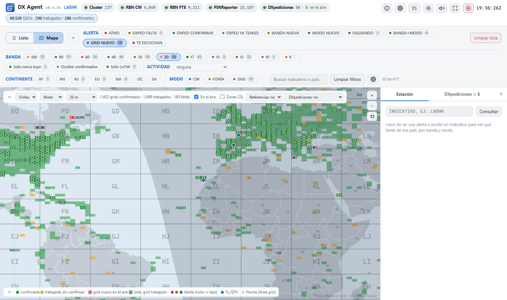

# DX Agent — Manual de usuario

*Versión 0.4.14 · Creado por Diego – LW5HR · Colaboradores: **Javi – LU5FF** (QA Product Advocate), Franco – LU2PWY, Juan Pablo – LU9HVR, Gustavo – LU7HW, Daniel – LU1HLH · [English version](MANUAL.en.md)*

DX Agent vigila el DX cluster y la Reverse Beacon Network (RBN), compara cada estación
reportada con tu log y te avisa cuando sale al aire una que todavía necesitás: un país nuevo,
una banda o un modo nuevos, una DXpedición que te suma algo, o una estación de tu lista de
seguimiento. Corre en tu PC y se maneja desde el navegador.

Contenido:

1. [Qué necesitás](#1-qué-necesitás)
2. [Instalarlo y abrirlo](#2-instalarlo-y-abrirlo)
3. [La primera configuración](#3-la-primera-configuración)
4. [La pantalla](#4-la-pantalla)
5. [Las alertas](#5-las-alertas)
6. [Sintonizar la radio y pasar el indicativo al logger](#6-sintonizar-la-radio-y-pasar-el-indicativo-al-logger)
7. [Que DX Agent vea tus QSOs al instante](#7-que-dx-agent-vea-tus-qsos-al-instante)
8. [DXpediciones](#8-dxpediciones)
9. [Activaciones: POTA, SOTA, IOTA...](#9-activaciones-pota-sota-iota)
10. [El mapa](#10-el-mapa)
11. [CQ DX Marathon](#11-cq-dx-marathon)
12. [LoTW](#12-lotw)
13. [Actualizar a una versión nueva](#13-actualizar-a-una-versión-nueva)
14. [Problemas frecuentes](#14-problemas-frecuentes)
15. [Ayuda y contacto](#15-ayuda-y-contacto)

---

## 1. Qué necesitás

- **Windows 10 u 11, Linux (x86_64) o una Mac (Apple Silicon o Intel).** El paquete ya trae
  todo lo necesario (incluido Python): no hay que instalar nada.
- **Conexión a internet**, para recibir los spots y bajar las listas de DXpediciones,
  países y LoTW.
- **Tu log**, de una de estas dos formas:
  - un archivo **ADIF** que escriba tu programa de log: por ejemplo los backups de Log4OM,
    o una exportación ADIF de cualquier otro programa;
  - o tu cuenta de **LoTW**, si no tenés un archivo ADIF: DX Agent baja de ahí todos los QSOs
    que subiste;
  - o nada todavía, si estás empezando de cero: DX Agent te crea un log nuevo (sección 3).
- Opcional: tu **contraseña de LoTW**, para que DX Agent sepa qué tenés confirmado aunque tu
  programa de log no esté sincronizado.

## 2. Instalarlo y abrirlo

1. Bajá el último `dx-agent-<versión>-windows.zip` de la página
   [Releases](https://github.com/lw5hr/dx-agent-download/releases/latest).
2. Descomprimilo donde quieras, por ejemplo en `Documentos`. Tu configuración y tus datos no
   quedan ahí, sino en una carpeta tuya que usan todas las versiones (sección 13): la carpeta
   del programa se puede reemplazar o borrar.
3. Hacé doble clic en **start-dx-agent.bat**. El panel se abre en el navegador, en
   **http://localhost:8073**.

Si Windows muestra un aviso de seguridad la primera vez (el archivo viene de internet),
elegí la opción para ejecutarlo (**Ejecutar**, o **Más información → Ejecutar de todas
formas**). Para que no aparezca: antes de descomprimir, clic derecho en el zip →
**Propiedades** → marcar **Desbloquear** → Aceptar.

**Cómo corre:** sin ventana. Mientras está abierto, volver a hacer doble clic en
start-dx-agent.bat solo abre el panel otra vez (si abrís una versión más nueva, detiene la
anterior y queda ella). Para cerrarlo, botón **Detener** arriba a
la derecha del panel. Si querés ver lo que va haciendo, usá **start-dx-agent-console.bat**,
que lo abre en una ventana de consola.

Podés guardar el panel en los favoritos del navegador: `http://localhost:8073`. Solo se
puede abrir desde tu PC; otras computadoras de la red no lo ven.

### En Linux

1. Bajá el último `dx-agent-<versión>-linux-x86_64.tar.gz` de la misma página
   [Releases](https://github.com/lw5hr/dx-agent-download/releases/latest).
2. Descomprimilo en una carpeta tuya y abrilo:

   ```sh
   tar -xzf dx-agent-<versión>-linux-x86_64.tar.gz
   cd dx-agent
   ./start-dx-agent.sh
   ```

   El panel se abre en el navegador, en **http://localhost:8073**, igual que en Windows.
   `./start-dx-agent-console.sh` lo corre en la terminal, para ver lo que va haciendo.

### En una Mac

1. Bajá el último `dx-agent-<versión>-macos.tar.gz` de la misma página
   [Releases](https://github.com/lw5hr/dx-agent-download/releases/latest). Sirve para
   cualquier Mac, con Apple Silicon (M1, M2...) o Intel.
2. Hacé doble clic para descomprimirlo, y mové la carpeta `dx-agent` adonde quieras, por
   ejemplo a Documentos.
3. Hacé doble clic en **start-dx-agent.command**, adentro de esa carpeta. El panel se abre en el
   navegador, en **http://localhost:8073**, igual que en Windows.

La primera vez, macOS dice que no lo puede abrir, porque no está firmado por Apple. Abrí
**Configuración del Sistema → Privacidad y seguridad**, bajá hasta el aviso sobre
start-dx-agent.command, hacé clic en **Abrir igualmente** y confirmá; después volvé a hacer doble
clic. Desde ahí alcanza con doble clic. O, en la Terminal:

```sh
cd ~/Documents/dx-agent
xattr -dr com.apple.quarantine .
./start-dx-agent.command
```

Las notificaciones van al Centro de notificaciones de la Mac (la primera vez macOS puede pedir
permiso).

Log4OM, N1MM, DXLog.net y OmniRig son programas de Windows: leer la base de Log4OM y sintonizar
con ellos funcionan solo en Windows. Todo lo demás es igual en Linux y en la Mac (incluidos los
QSOs por UDP de WSJT-X y sintonizar con flrig, Hamlib o TCI).

## 3. La primera configuración

La primera vez el panel muestra una franja amarilla, porque todavía no sabe dónde está tu
log. Hacé clic en **Configuración** (arriba a la derecha) y completá:

1. **Estación**
   - **Indicativo:** el tuyo. Se usa para entrar al cluster y a la RBN.
   - **Tu log:** *Archivo ADIF*, *Solo LoTW* o *Empezar de cero (log nuevo)*: DX Agent crea un
     log vacío, `data\<INDICATIVO>.adi` en tu carpeta de DX Agent, y le agrega los QSOs que tus programas le mandan al
     loguearlos (WSJT-X, N1MM... ver la sección 7). Cuando empieces a usar un programa de log,
     importá ese archivo ahí y elegí Archivo ADIF.
   - **Ruta del log:** hacé clic en **Buscar…** y elegí el archivo. Si elegís un backup de
     Log4OM con fecha (`LW1ABC_20261016_124613_backup.adi`), DX Agent lo convierte en
     `…/LW1ABC_*_backup.adi`, así usa siempre el más nuevo. **Probar** muestra qué archivo
     encontró y cuántos QSOs tiene.
   - **Grid locator:** tu cuadrícula (GF05, FN31pr...). Vacío = la toma de tu log. Se usa para
     el mapa, el rumbo de antena y "cerca tuyo".
   - **Tus otros indicativos** (opcional; por ejemplo uno de concurso): **+ Agregar un
     indicativo**, el indicativo y su log: un archivo ADIF o directamente la base de datos de
     Log4OM (el archivo `.SQLite`, sin exportar nada). Las alertas, el DXCC y el WAZ suman todos
     tus indicativos juntos; el selector del encabezado permite ver uno solo.
2. **LoTW** (opcional): tu usuario y contraseña de LoTW, **Probar ingreso**. La contraseña
   queda guardada cifrada para tu usuario de Windows (en Linux y en la Mac, legible solo por vos),
   nunca en texto.
3. **Alertas:** qué tipos de alerta querés, en qué bandas y modos. Para empezar, los valores
   de fábrica andan bien.
4. **Radio (botón Sintonizar):** el programa que maneja tu radio (ver sección 6). Si no
   querés que DX Agent mueva la radio, dejalo en *Desactivado*.
5. Hacé clic en **Guardar y aplicar**. No hace falta reiniciar: en unos segundos vuelve a
   leer el log (arriba dice "Leyendo tu log…") y se conecta a las fuentes de spots.

Si algo está mal (un indicativo inválido, ninguna banda elegida...), aparece una lista en
rojo junto al botón y no se guarda nada hasta corregirlo.

El panel aparece en el idioma del navegador; el botón **EN/ES/PT** del encabezado lo cambia:
inglés, español o portugués (Brasil).

## 4. La pantalla


**Encabezado:** tu indicativo (con varios, un selector: **Todos** o uno solo, para ver qué le
falta a ese); una pastilla por cada fuente de spots (verde = conectada,
ámbar = conectando, rojo = caída); la pastilla **DXpediciones** ("48 · 6 en el aire": cuántas
están dentro de sus fechas y cuántas se spotearon en los últimos 15 minutos; un clic abre su
pestaña); los totales de tu log, en una pastilla azul; botones con íconos (al pasar el mouse
dicen qué hace cada uno): **Acerca de** ⓘ, **Configuración** ⚙, **EN/ES/PT**, **Tema** (claro /
oscuro / automático), **Sonido** (un pitido para las alertas importantes, apagado de fábrica),
**Pantalla completa** (cuatro esquinas; también la tecla **F**, se sale con F o Esc) y
**Detener**, en rojo; el reloj UTC. **Acerca de** cuenta qué es DX Agent, quién lo hizo y sus
colaboradores, y tiene los links para apoyarlo, al sitio, a este manual y para reportar un
problema.

**Filtros**, arriba de la lista, en tres filas:

- botones por **tipo de alerta** (solo los tipos activados en Configuración), **banda** y **modo**
  (sin ninguno marcado se ve todo). Cada opción dice cuántas estaciones mostraría, con los demás
  filtros como están: con 20 m elegido, los modos dicen cuántas hay en 20 m;
- **Continente** (AF, AN, AS, EU, NA, OC, SA): deja las
  estaciones de los continentes elegidos, para quedarte con hacia donde apunta tu antena. Tu propio
  indicativo spoteado se ve siempre;
- **Actividad:** solo activaciones POTA, SOTA, IOTA... (sección 9);
- **Solo cerca tuyo:** solo las estaciones que escucha alguien cerca tuyo. Solo oculta las demás: siguen avisando.
  El ajuste **Avisar solo si se escucha cerca tuyo** (Configuración → Alertas) es otra cosa: con él, una estación que solo
  se escucha lejos no avisa nunca, y donde hay pocos receptores cerca la lista queda casi vacía (el panel avisa cuántas no
  avisaron). Casi siempre lo que conviene es el filtro. Lo que decodifica tu propio WSJT-X siempre cuenta como cerca
  (sección 7);
- **Ocultar confirmados:** saca lo que ya tenés confirmado en esa banda y modo;
- **Solo LoTW:** solo las estaciones que subieron a LoTW en los últimos 12 meses y las
  DXpediciones que anunciaron LoTW;
- un cuadro de **búsqueda** por indicativo o país;
- **Limpiar filtros** vuelve a mostrar todo. El navegador recuerda los filtros.
- **⚙** (junto a Limpiar filtros, o Configuración → **Filtros sobre la lista**): cuáles de Continente, Solo cerca tuyo,
  Ocultar confirmados, Solo LoTW y Actividad se ven. Uno oculto queda apagado. Los tipos de alerta, las bandas y los modos
  son los de tus alertas (Configuración → Alertas).
- **Plegar los filtros:** el chevron junto a **Lista** / **Mapa** los pliega a una línea que dice
  qué está elegido ("FILTROS 20m · CW", resaltada mientras hay un filtro), para dejarle más lugar
  a la lista; quedan la búsqueda, Limpiar filtros, la cantidad y Limpiar lista. El navegador lo
  recuerda.

**La lista de alertas:** una fila por alerta, la más nueva arriba, con el color de su tipo.
Columnas: hora UTC, tipo de alerta, indicativo, frecuencia, banda, modo, país, **qué te falta**,
LoTW, **cerca tuyo** y quién la escuchó. Las filas nuevas destellan. Cuando la estación vuelve a
aparecer en la misma banda y modo, su fila se actualiza (hora, frecuencia, quién la escuchó, ×N):
muestra dónde está ahora. Las filas se atenúan a los 10 y a los 30 minutos del último spot de la
estación ahí.

**Limpiar lista** (en rojo, arriba a la derecha): vacía la lista, después de preguntar. Lo que
siga en el aire vuelve a avisar en su próximo spot.

**Ordenar por una columna:** al hacer clic en el encabezado de una columna la lista se ordena por
ella: por frecuencia, por banda, por modo (CW, fonía y digitales juntos), por país... **Alerta** y
**Qué te falta** ponen primero lo más buscado, **LoTW** las subidas más recientes. Otro clic lo
invierte, y un tercero vuelve a lo más nuevo arriba. Una flecha muestra el orden. Las alertas
nuevas entran en su lugar, y el navegador recuerda el orden.

**A la derecha, la pestaña Estación:** al hacer clic en una fila (en el indicativo o en la
frecuencia) se abre la estación:

- una tarjeta con el indicativo, el país, sus zonas y su puesto en el **Most Wanted** de Club Log;
- los dos **rumbos de antena**, grandes, cada uno con su brújula y su distancia: el paso corto en
  azul y el paso largo en naranja;
- la grilla banda × modo de ese país: **C** verde = confirmado, **W** ámbar = trabajado, gris =
  falta. **Al pasar el mouse sobre una C o una W** ves los QSOs que la hicieron (indicativo,
  fecha, modo, ✓ si está confirmado): sabés enseguida si ese QSO de 20 m fue esta DXpedición u
  otra estación de hace años;
- **dónde está en el aire ahora**, en esa misma grilla: un **anillo verde** en cada banda y modo
  donde la spotearon en los últimos 15 minutos, y un punto ● sobre la banda. El cuadro del
  **spot más reciente parpadea**: ahí está ahora la estación; los otros quedan con el anillo
  fijo, y el parpadeo se mueve cuando la spotean en otra banda. Una DXpedición en varias bandas
  a la vez (por ejemplo S9R) muestra un anillo en cada una, y parpadea la más reciente. Pasando
  el mouse por un cuadro con anillo ves cuándo, dónde y quién la spoteó; **con un clic sintonizás
  ahí** (con una radio configurada, sección 6). Sin spots durante 15
  minutos, el anillo se apaga. Un anillo sobre un cuadro vacío: está en el aire en una banda que
  te falta;
- si ya trabajaste ese indicativo exacto, su estado de LoTW y, si es una DXpedición, sus datos;
- si la estación dijo su grid locator en el aire (tu WSJT-X, FT8/FT4 de la RBN), su **grid** y cómo
  lo tenés en la banda en que la spotearon: "Grid DN39 · 20 m: GRID NUEVO", o confirmado, y en qué
  otras bandas lo trabajaste. La grilla banda × modo de arriba es la del país; esta fila es la del
  grid;
- con el CQ DX Marathon activado, qué te suma en el Marathon (sección 11);
- para una estación en un **parque POTA o una cumbre SOTA**, una tarjeta con lo que dicen pota.app
  o SOTA: nombre, tipo y lugar, cuántas activaciones y QSOs, quién la activó primero, sus últimas
  activaciones, si **vos** la trabajaste y en qué bandas (o "Nueva para vos"), y enlaces;
- **Quién lo escucha**, los receptores más cercanos a vos primero, y el botón **Consultar
  PSKReporter** para FT8/FT4 (o, con PSKReporter en vivo, los receptores a medida que la
  reportan: sección 5);
- **Ver solo** este indicativo, **☆ seguimiento** para sumarlo a tu lista de seguimiento,
  **Spotear** (ver abajo), sus **Últimos spots** y enlaces a QRZ.com, HamQTH y DXWatch.
  **Últimos spots** y **Quién lo escucha** son pastillas: al pasar el mouse dicen qué lista cada
  una.

**Spotear** (el botón de la antena) publica un spot de la estación en el DX cluster al que está
conectado DX Agent, con tu indicativo: por ejemplo `DX 14025.0 3Y0K up 2`. Abre un formulario
chico con la frecuencia de la fila en la que hiciste clic (la podés cambiar) y un comentario
(hasta 30 caracteres, sin acentos), y pide confirmación. Después te dice si el cluster lo tomó:
**publicado** cuando te lo devuelve, **enviado** cuando no lo devuelve (W3LPL, por ejemplo), o lo
que respondió si lo rechazó. Como máximo un spot cada 30 segundos; con el cluster apagado o caído
el botón queda gris.


**La pestaña DXpediciones:** ver la sección 8. **La pestaña Marathon:** ver la sección 11.
Con un clic en un país del mapa, la pestaña Estación muestra ese país (sección 10).

**Plegar el panel:** el chevron a la derecha de las pestañas pliega el panel de la derecha a una
tira con sus íconos, donde siguen las DXpediciones en el aire y el puntaje del Marathon; un clic
en un ícono lo abre en esa pestaña. Mientras está plegado, al pasar el mouse por una fila de la
lista aparece la ficha de esa estación: su país, su estado y su grilla banda × modo. El
navegador lo recuerda.

**Lista / Mapa:** a la izquierda de los filtros, cambia entre la lista y el mapa (sección 10).

## 5. Las alertas

| En el panel | Qué quiere decir | De fábrica |
|-------------|------------------|------------|
| **ATNO** | País que nunca trabajaste | activada, con notificación de Windows |
| **DXPED FALTA** | DXpedición activa que te suma un país, una banda o un modo | activada |
| **DXPED CONFIRMAR** | DXpedición de un país trabajado pero no confirmado en esa banda o modo | activada |
| **DXPED YA TENGO** | DXpedición que ya tenés confirmada en esa banda y modo (gris) | activada |
| **BANDA NUEVA** | País trabajado, pero no en esta banda | activada |
| **MODO NUEVO** | País trabajado, pero no en este modo (CW, fonía, digital) | activada |
| **SIGUIENDO** | Un indicativo de tu lista de seguimiento | activada |
| **BANDA+MODO** | País no trabajado en esta combinación de banda y modo | desactivada |
| **GRID NUEVO** | Un grid que no trabajaste en esta banda, en cualquier modo (VUCC, FFMA). Solo avisan los spots que dicen el locator: los decodes de tu WSJT-X y FT8/FT4 de la RBN (sección 10) | desactivada |
| **INDICATIVO NUEVO** | Este indicativo exacto no está en tu log (genera muchísimas alertas) | desactivada |
| **MARATHON** | Un país o una zona CQ que todavía no trabajaste en el CQ DX Marathon (sección 11) | activada, si seguís el Marathon |
| **TE ESCUCHAN** | Spotearon tu propio indicativo, en cualquier banda y modo: la fila va resaltada en rosa y dice a qué distancia y en qué país está el skimmer ("te escuchan a 8.912 km, en United States"). Al hacer clic se ven todos los receptores que te escucharon, también en el mapa | activada |

- **Qué te falta** dice exactamente qué te suma la estación: "banda nueva", "17m DIGI nunca
  trabajado", "grid EN52 nunca trabajado en 6m", "país no confirmado", o "ya lo tenés".
- **Confirmado** es LoTW o QSL en papel, como en el DXCC de la ARRL (eQSL no cuenta). Solo
  cuentan las entidades vigentes: una borrada que traen QSOs viejos (85 Antillas Neerlandesas,
  como la informa LoTW) no entra en ningún total, tampoco en los trabajados y confirmados del
  encabezado.
- **LoTW** dice si la estación sube a LoTW (y cuándo subió por última vez), si la DXpedición
  anunció LoTW, o "no LoTW".
- **Cerca tuyo:** **● 732 km · 7 dB** en verde = la escuchó un receptor dentro de tu radio
  "cerca" (1.500 km de fábrica); en gris, la distancia al receptor más cercano; **—** = nadie
  la reportó en los últimos 15 minutos.
- La misma alerta no se repite durante 15 minutos (se cambia en Configuración), ni siquiera al
  guardar la Configuración o volver a abrir DX Agent: la estación vuelve a la lista cuando la
  spotean, pero no muestra otra notificación ni vuelve a sonar.
- **Alertas de la RBN: esperar a un 2.º skimmer** (Configuración → Alertas, activado de fábrica):
  una estación que escuchó un solo skimmer de la RBN avisa cuando la escucha otro skimmer, o
  alguien en el cluster o en PSKReporter (unos minutos como mucho), así un indicativo mal
  decodificado por un skimmer (P9DX como ATNO) no avisa. Los spots del cluster, que publican
  personas, avisan enseguida. Desmarcado: avisan enseguida, marcados con **?**.
- **Un tipo de alerta que apagás en Configuración también sale de la lista:** una alerta solo de
  ese tipo se va, y una que tiene otro motivo pasa a mostrarlo (BANDA NUEVA en vez de INDICATIVO
  NUEVO).
- Una alerta puede ser de varios tipos a la vez: una BANDA NUEVA que además es un grid nuevo
  aparece con el filtro **GRID NUEVO**, y con ese filtro elegido la fila dice GRID NUEVO.
- En Configuración → Alertas también están **Dejar solo la última fila de cada estación** (mismo
  indicativo, frecuencia y modo) y **Quitar de la lista después de** N minutos sin spot (0 =
  nunca): las dos apagadas de fábrica.
- La lista guarda las últimas 500 alertas. Cuando se llena, se van primero las de INDICATIVO
  NUEVO; las demás quedan al menos una hora.
- Cuando trabajás la estación, sus alertas en la lista cambian solas: una BANDA+MODO que ya
  trabajaste deja de serlo (y de aparecer con ese filtro), una DXpedición pasa a DXPED CONFIRMAR o
  DXPED YA TENGO, y una alerta que ya no te suma nada queda como **TRABAJADO**, en gris.
- Las **notificaciones de Windows** salen de fábrica solo para ATNO; en Configuración se
  pueden activar para más tipos. Al hacer clic en una se abre el panel en esa estación.

**Lista de seguimiento:** indicativos que querés que te avisen siempre que salgan, aunque no
te sumen nada. Admite comodines, por ejemplo `VP8*`. Se edita en Configuración o con la ☆ de
la pestaña Estación. **Ignorar** hace lo contrario: esos indicativos nunca alertan. En los
filtros, **SIGUIENDO** junto con otro tipo muestra solo los que seguís que además son de ese
tipo: **SIGUIENDO** + **BANDA+MODO** son tus indicativos en seguimiento en una banda y modo que
te faltan.

**PSKReporter en vivo:** en Configuración → Fuentes de spots → **PSKReporter** podés elegir
**Cuando lo pedís** (una consulta cada 5 minutos, con el botón de la pestaña Estación; es lo de
fábrica) o **En vivo (MQTT)**: los reportes de PSKReporter a medida que llegan, sin límite, para la
estación abierta en la pestaña Estación y las alertas digitales de la lista. Sus receptores
cuentan para "cerca tuyo" y el mapa sin apretar ningún botón, y una pastilla **PSKReporter** en el
encabezado muestra la conexión. Necesita tu grid locator. Con **Avisar solo si se escucha cerca
tuyo**, una estación digital que no avisó por escucharse solo lejos avisa apenas un receptor de
PSKReporter cerca tuyo la reporta en esa banda.

## 6. Sintonizar la radio y pasar el indicativo al logger

Con una radio configurada (Configuración → **Radio (botón Sintonizar)**), al hacer clic en
la **frecuencia** de una alerta tu programa mueve la radio ahí y la estación se abre a la
derecha. La pestaña Estación también tiene un botón **Sintonizar**. Un mensaje arriba a la
derecha dice si funcionó.

| Programa | Qué hay que hacer en el programa | ¿Cambia el modo? |
|----------|----------------------------------|------------------|
| **Log4OM 2** | Settings → Software integration → Connections → activar **Remote control** (puerto 2241) | sí, si Log4OM usa OmniRig |
| **N1MM Logger+** | nada | no |
| **DXLog.net** | Options → Configure network: agregar el puerto `13064` al **UDP broadcast listener**; Options → Broadcast → **Receive broadcasts** | no |
| **OmniRig** | elegir en DX Agent la radio 1 o 2 de OmniRig | sí |
| **Hamlib (rigctld)**, **flrig**, **DXLab Commander** | que el programa esté abierto | sí |
| **TCI** (AetherSDR para FlexRadio, ExpertSDR, Thetis) | AetherSDR: Settings → **Autostart TCI with AetherSDR** (o **Enable** en su applet TCI, puerto 50001) | sí |

- **Con Log4OM, además de la frecuencia se completa el indicativo** en su ventana de QSO,
  listo para loguear. Si ya escribiste un indicativo a mano ahí, Log4OM no lo reemplaza.
- **Con Log4OM, el modo** cambia por OmniRig, el programa con el que Log4OM maneja la radio:
  con **También cambiar el modo** marcado, DX Agent usa la radio de OmniRig que está en línea y
  Log4OM la sigue. Si Log4OM maneja tu radio de otra forma, cambia solo la frecuencia.
- **Radios que necesitan su modo de datos para FT8** (por ejemplo un IC-9100 en USB-D): poné la
  radio en USB-D una vez. Desde ahí, los clics en spots de FT8/FT4 solo cambian la frecuencia y
  el USB-D se mantiene. Un spot de fonía la pasa a USB o LSB, y el siguiente spot de FT8 queda en
  USB: volvé a poner USB-D a mano. Con CW pasa lo mismo: una radio en CW o CW-R lo conserva.
- **FlexRadio con AetherSDR (TCI), en prueba:** Sintonizar mueve el slice que transmite (el de
  TX; hasta que DX Agent sabe cuál es, el que tiene el foco) y pone el modo (CW, USB/LSB, RTTY,
  DIGU para FT8). Con dos o más slices abiertos, la pestaña Estación tiene un botón Sintonizar por
  slice: su letra (o su número de RX, hasta que tuvo el foco) y dónde está ahora; el de TX está
  marcado **TX**, y se destaca el que sintonizan las frecuencias de la lista. Elegir un slice ahí
  lo sintoniza pero no le da el foco en AetherSDR: AetherSDR no deja que otro programa lo cambie.
  Con **Mostrar las alertas en el panadaptador de la radio**
  (activado de fábrica), cada estación de la lista aparece en el panadaptador de AetherSDR con su
  color, su título y su país; se mueve cuando cambia de frecuencia y se saca cuando dejan de
  spotearla. Un clic en una sintoniza ahí y la abre en la pestaña Estación de DX Agent. Una
  pastilla **TCI** en el encabezado muestra la conexión; si abrís AetherSDR después de DX Agent,
  Sintonizar se conecta en el momento. Está probado con la radio de demostración
  de AetherSDR; si lo usás con una Flex, contanos cómo te fue en el
  [issue #10](https://github.com/lw5hr/dx-agent-download/issues/10).
- **WSJT-X:** marcá en DX Agent **Mandar también el indicativo a WSJT-X** y en WSJT-X
  Settings → Reporting → **Accept UDP requests**. Un clic en un spot de FT8/FT4 pone la radio
  en la frecuencia de FT8/FT4, completa **DX Call** y **DX Grid** y mueve el audio a la
  frecuencia de la estación; vos hacés clic en **Enable Tx**.

## 7. Que DX Agent vea tus QSOs al instante

DX Agent lee tu archivo de log al arrancar y cada vez que cambia. Pero muchos programas
escriben el archivo cada tanto (Log4OM, por ejemplo, hace un backup cada un rato), y mientras
tanto una estación que acabás de trabajar sigue alertando. Para evitarlo, tu programa de log
puede avisarle cada QSO apenas lo guardás:

- **Log4OM 2: no hay que hacer nada.** DX Agent lee los QSOs nuevos directo de la base de
  Log4OM, cada 10 segundos.
- **Otros programas, por UDP:** agregá en tu programa el destino `127.0.0.1`, puerto `12065`,
  junto a los que ya tengas:

| Programa | Dónde se configura |
|----------|--------------------|
| **N1MM Logger+** | Config → Configure Ports… → **Broadcast Data**: marcar **Contacts** y agregar `127.0.0.1:12065` |
| **DXLog.net** | Options → Configure network: QSO broadcast `127.0.0.1:12065`; Options → Broadcast: QSO y **Use N1MM QSO format** |
| **HRD Logbook** | Tools → Configure → QSO Forwarding → **UDP Send**: `127.0.0.1`, puerto `12065` (todavía sin probar con HRD) |
| **WSJT-X / JTDX** | para sus QSOs, en general no hace falta: tu programa de log los recibe y se los pasa a DX Agent. Sí para lo que decodifican (abajo) |

- **Programas sin UDP** (DXKeeper, Logger32, N3FJP...): si escriben un archivo ADIF a medida
  que logueás (o lo exportan solos), agregá ese archivo en Configuración como segundo
  archivo de log, debajo del principal.

Cuando llega un QSO nuevo, las alertas que ya están en la lista se actualizan solas y dejan
de decir "banda nueva" si ya la trabajaste. Los QSOs que llegan por UDP se guardan hasta que tu
log los tiene: si cerrás DX Agent antes, no se pierden.

### Lo que decodifica tu WSJT-X

Si WSJT-X (o JTDX) le manda sus mensajes a DX Agent, cada estación que decodificás es un spot más,
como uno del cluster: si es lo que buscás (país nuevo, banda nueva, lista de seguimiento...) aparece
en la lista aunque nadie la haya spoteado. Cuenta como escuchada **a 0 km tuyo**, así que el filtro
**Solo cerca tuyo** siempre la muestra. En la fila dice tu indicativo, el SNR y el mensaje
(WSJT-X), y una pastilla **WSJT-X** en el encabezado muestra los decodificados que llegan.

Llega al mismo puerto que los QSOs. WSJT-X manda a un solo destino (Settings → Reporting → UDP
Server), así que si ya lo usa otro programa (Log4OM, JTAlert, GridTracker):

- **un grupo multicast:** en WSJT-X, UDP Server `239.255.0.1`, puerto `2237`; en DX Agent, en
  `config.toml`, `[logbook]` → `udp_group = "239.255.0.1"` y `udp_port = 2237`. Lo escuchan a la
  vez DX Agent y los programas que se unen a grupos (GridTracker, JTAlert);
- o **que el programa que ya lo recibe lo reenvíe** a `127.0.0.1:12065` (JTAlert y GridTracker
  pueden reenviar los mensajes de WSJT-X).

## 8. DXpediciones


La pestaña **DXpediciones** muestra las activas y las que empiezan en los próximos 30 días,
reunidas de NG3K, 425 DX News y Club Log.

- Cada tarjeta dice qué te suma: **ATNO**, **No confirmado** o cuántas bandas tenés (por
  ejemplo "3 de 10 bandas").
- **EN EL AIRE** (borde verde) = la spotearon en los últimos 15 minutos, con su frecuencia
  (clic para sintonizar).
- **Orden:** **En el aire** (las que están transmitiendo primero), **Most Wanted** (el país
  más buscado según Club Log primero) o **Fecha**.
- **Solo las que faltan** oculta las que ya tenés en la mayoría de las bandas (las que están
  en el aire se ven igual).
- **Cuando termina:** al pasar su fecha de fin anunciada, DX Agent vuelve a leer las fuentes
  antes de sacarla de la lista. Si alguna la extendió, sigue con la fecha nueva.
- Al abrir una DXpedición que sube su log a Club Log, DX Agent busca tu indicativo en su log:
  te dice en qué bandas y modos estás, y te avisa si un QSO tuyo no figura en el de ellos.

## 9. Activaciones: POTA, SOTA, IOTA...


El menú **Actividad** (junto a los filtros de modo) muestra solo activaciones: **POTA, SOTA,
IOTA, WWFF, BOTA, COTA** (castillos), **LOTA** (faros), **TOTA, ROTA, JOTA, YOTA** y **EME**,
con cuántas estaciones hay en la última hora. La primera opción, **ninguna**, apaga el filtro de
Actividad.

- Con una actividad elegida, la lista muestra también sus spots que no generaron alerta
  (filas **SPOT**), por ejemplo un parque en un país que ya tenés. Va una fila por estación,
  banda y modo (el spot más reciente, con **×N** la cantidad), en gris si no te suma nada y con
  color si todavía te suma algo.
- Cada fila dice la referencia (`POTA US-5584`, `SOTA LU/SA-001`...). Pasando el mouse se ve el
  nombre del parque o de la cumbre, y en las cumbres su altura y sus puntos.
- **REF NUEVA:** con una actividad elegida, una cumbre, parque, isla o castillo que no
  trabajaste **en esa banda** se marca como nuevo, aunque el país ya lo tengas confirmado.
  DX Agent sabe qué trabajaste por las referencias de tu log y por tus QSOs con activadores
  que vio en el aire (desde que lo usás).
- En el mapa, con una actividad elegida, las cumbres son montañas y los parques pinos, en su
  ubicación real: en rojo si no trabajaste esa referencia, ámbar trabajada, verde confirmada. Sin
  actividad elegida son un punto como las demás estaciones.
- **La pestaña Referencias** (aparece cuando hay una actividad elegida): todas las cumbres,
  parques, islas y castillos que trabajaste (POTA, SOTA, WWFF, IOTA, WCA), programa por programa:
  cuántas trabajadas, confirmadas y confirmadas por QSL en papel, y cada una con su nombre y lugar,
  las bandas, **C** confirmada / **W** trabajada y tu último QSO. Se pueden ver todas, las
  confirmadas, las de **QSL** (tarjeta en papel) o las sin confirmar. Al hacer clic en una se ven
  **tus QSOs con ella** (indicativo, fecha, banda, modo, ✓ confirmado en LoTW, ✓ QSL por tarjeta) y,
  en POTA o SOTA, su tarjeta. *Confirmada* quiere
  decir que el QSO está confirmado en LoTW o por QSL; el crédito oficial de cada programa está en
  su sitio (pota.app, sotadata, wwff.co).

## 10. El mapa


Clic en **Mapa** (al lado de **Lista**). Los filtros valen igual que en la lista.

- **Puntos:** las alertas, con el color de su tipo. **Rombos:** las DXpediciones activas (borde
  verde = en el aire). **Montañas y pinos:** cumbres y parques. **Punto azul:** tu QTH.
- Un punto se atenúa a los 10 minutos del último spot de la estación y más a los 30: un punto
  atenuado es donde estuvo, no donde está. Pasando el mouse se ve hace cuánto.
- La zona sombreada es donde es de noche (su borde es la línea gris).
- Al elegir una estación se dibuja la ruta desde tu QTH, con rumbo y distancia, y los
  receptores que la escucharon.
- **Clic en un país** (o cerca de una isla chica): la pestaña Estación lo muestra como cuando
  consultás un indicativo: su tarjeta, los rumbos a su centro, el estado y la grilla.
- Rueda del mouse o **+ / −** para el zoom, arrastrar para moverse, **⟲** para ver el mundo.
  Arrastrando hacia el este o el oeste se da la vuelta al mundo (pasando el Pacífico, el mapa
  sigue del otro lado).
- **DXCC** (arriba a la izquierda) pinta cada entidad según tu diploma: verde = confirmada,
  ámbar = trabajada, rojo = falta. Se puede elegir Mixto, Fonía, CW, Digital, una banda,
  Satélite o el Challenge.
- **WAZ** pinta las 40 zonas CQ de la misma forma, con sus variantes (por modo, por banda,
  5BWAZ...).
- Con una sola banda (o un solo modo) elegidos en los filtros de arriba, DXCC y WAZ pintan esa
  banda ("12 m (filtro)"), salvo que hayas elegido una en sus propios menús.
- **Grillas** (en el mismo menú que DXCC y WAZ): la grilla Maidenhead, como GridTracker. Los 324
  fields (FN, GF...) con sus nombres y, con zoom, los grids (FN31) con los suyos. Los grids que
  trabajaste se pintan: verde confirmado, ámbar trabajado. Se elige el modo (Mixto, Fonía, CW,
  Digital o Satélite) y la banda: **6 m** para el FFMA, una banda para el VUCC. El resumen dice
  cuántos grids tenés confirmados, trabajados y en cuántos fields. Sigue las reglas del VUCC:
  confirmado es LoTW o QSL en papel (eQSL no), y las repetidoras e internet no cuentan. El grid
  es el que tu programa de log guardó con el QSO (y cada uno de VUCC_GRIDS, para una estación
  sobre una línea o una esquina); un QSO guardado sin locator no cuenta para ningún grid.
- **En el aire** (en la vista Grillas, marcado de fábrica): las estaciones oídas con locator en los
  últimos 15 minutos, con alerta o sin ella, en su grid: las que decodifica tu WSJT-X y los spots
  de FT8/FT4 de la RBN, en las bandas y modos en que alertás. Borde **rojo**: un grid que no
  trabajaste en la banda de esa estación; borde verde: uno que ya tenés. Un clic en una la abre en
  la pestaña Estación, con su frecuencia y el rumbo a su grid.
- Pasando el mouse por un grid se ve qué tenés ahí en la banda y el modo elegidos (cada banda, sus
  modos, ✓ confirmado) y quién está en el aire en él.
- **Referencias** (al lado de DXCC / WAZ): tus parques POTA y cumbres SOTA, en verde confirmadas y
  en ámbar trabajadas. Un clic en uno muestra su tarjeta, el rumbo y la distancia, y tus QSOs con
  él, en la pestaña Estación.
- **DXpediciones** (al lado de DXCC / WAZ / Referencias): qué rombos se ven: las que están **en el
  aire** (de fábrica), **las que faltan**, **todas** las activas, o **no**. La estación abierta en la
  pestaña Estación se ve siempre.
- Varias DXpediciones en el mismo lugar (por ejemplo cuatro en Koror, Palau) van en un círculo chico
  alrededor, así se puede hacer clic en cada una.
- **Plegar:** la barra de arriba (DXCC / WAZ / Grillas y sus menús) y la leyenda de abajo tienen
  un chevron que las pliega a una línea, para dejarle más lugar al mapa. El navegador lo recuerda.



## 11. CQ DX Marathon

El [CQ DX Marathon](https://dxmarathon.com) suma un punto por cada país y uno por cada zona CQ
que trabajás: en el año (del 1 de enero al 31 de diciembre) o en el **Sprint**, diez días de
octubre. Para seguirlo: Configuración → **CQ DX Marathon** → **Seguir los países y zonas CQ que
trabajo**; elegí el anual o el Sprint (con sus fechas), los modos que cuenta tu participación
(todos, uno solo, o **Classic**: CW y SSB) y, si tenés varios indicativos, cuáles suman (hasta 2,
como permiten las reglas).

- **La pestaña Marathon** (al lado de DXpediciones) muestra el período, tu puntaje (países +
  zonas), las 40 zonas CQ (en verde, las trabajadas) y los países: **Trabajados**, con el QSO
  que cuenta (con un clic se abre la estación), o **Faltan**, con un buscador. El número de la
  pestaña es tu puntaje.
- **Alerta MARATHON** (violeta): una estación que te suma un país o una zona, aunque ese país ya
  lo tengas confirmado para el DXCC. Las alertas de país y de zona se pueden apagar por
  separado. El filtro MARATHON y la pestaña aparecen solo mientras seguís el Marathon.
- **Países:** la lista CQ DX Countries: las entidades DXCC más Sicilia (IT9), Italia africana
  (IG9/IH9), Shetland (GM/s), Turquía europea (TA1), Isla del Oso (JW/b) y 4U1VIC.
- **Zonas:** la del QSO en tu log y, si no la tiene, la del indicativo. Una estación de EE. UU.,
  Canadá o Rusia puede estar en otra zona que la que indica su indicativo.
- DX Agent no envía tu participación: al final subí tu ADIF en
  [entry.dxmarathon.com](https://entry.dxmarathon.com).

## 12. LoTW

- **Quién sube a LoTW:** DX Agent baja cada día la lista pública de la ARRL y en cada alerta
  muestra si la estación sube a LoTW. No necesita tu contraseña.
- **Tus confirmaciones:** con tu usuario y contraseña de LoTW (Configuración → LoTW), DX Agent
  baja tus QSL confirmadas cada 12 horas, así "confirmado" está al día aunque tu programa de
  log no se haya sincronizado. La primera descarga puede tardar unos minutos; si LoTW está
  ocupado o no responde, DX Agent reintenta solo cada 10 minutos y sigue donde quedó.
- **LoTW como log:** si no tenés archivo ADIF, en Configuración → Estación → **Tu log**
  elegí **Solo LoTW**. Solo cuenta lo que subiste a LoTW.
- **Varios indicativos:** alcanza con una cuenta de LoTW con los certificados de todos tus
  indicativos: cada uno toma sus confirmaciones.

## 13. Actualizar a una versión nueva

Una pastilla junto al número de versión te avisa cuando sale una nueva, con un link a su página
(DX Agent le pregunta a GitHub cada hora; no se manda nada tuyo ni se instala nada). Para
actualizar:

1. Bajá el paquete nuevo y descomprimilo donde quieras: en otra carpeta o encima de la anterior.
2. Abrilo como siempre con **start-dx-agent.bat** (Linux: `./start-dx-agent.sh`; Mac:
   **start-dx-agent.command**). Si la versión anterior está corriendo, se detiene sola y queda la
   nueva.
3. La carpeta de la versión vieja se puede borrar.

**Tu configuración y tus datos** (`config.toml` y la carpeta `data`: el historial de alertas, la
contraseña de LoTW guardada, el log si empezaste de cero) no están en la carpeta del programa,
sino en una carpeta tuya que usan todas las versiones:

| Sistema | Carpeta |
|---|---|
| Windows | `%APPDATA%\DX Agent` |
| Mac | `~/Library/Application Support/DX Agent` |
| Linux | `~/.config/dx-agent` |

**Configuración** muestra la ruta exacta. Hasta la 0.4.4 se guardaban en la carpeta del
programa: la primera vez que abrís una versión más nueva, copia tu configuración y tus datos
desde ahí (o desde la versión anterior que esté al lado) y lo avisa en el panel. La versión vieja
queda como estaba.

## 14. Problemas frecuentes

| Qué pasa | Qué hacer |
|----------|-----------|
| Franja amarilla "No se encontró ningún archivo ADIF" | Configuración → **Buscar…** el archivo del log, **Probar** hasta que lo encuentre, y **Guardar y aplicar** |
| El panel no abre | Abrí `http://localhost:8073` a mano. Si dice que el puerto está ocupado, otro programa (u otra copia de DX Agent) lo usa |
| "Se perdió la conexión con DX Agent" | DX Agent se cerró: abrilo de nuevo con start-dx-agent.bat (Mac: start-dx-agent.command; Linux: start-dx-agent.sh); la página se reconecta sola |
| Una estación que acabo de trabajar sigue alertando | Ver la sección 7. Sin aviso del programa de log, se actualiza cuando tu programa escribe el archivo ADIF |
| Tarda en arrancar con un log muy grande | La primera vez lee todo el log (con 250.000 QSOs, unos 15 segundos); después guarda un caché en `data\cache` (en tu carpeta de DX Agent) y arranca en un segundo, salvo que el log haya cambiado |
| Demasiadas alertas | En Configuración → Alertas dejá solo **ATNO** y **DXpedición**, o sacá bandas que no operás |
| Muy pocas alertas del cluster | Es normal: el cluster manda pocos spots por minuto y la RBN suele reportar primero la misma estación. Si un servidor sigue conectado pero no manda ningún spot en 10 minutos, DX Agent pasa solo al siguiente |
| No aparecen notificaciones de Windows | Configuración → **Mostrar notificaciones**, y en Windows: Configuración → Sistema → Notificaciones (incluida "Windows PowerShell") |
| Mac: "No se puede abrir start-dx-agent.command" | No está firmado por Apple: Configuración del Sistema → Privacidad y seguridad → **Abrir igualmente** (sección 2) |
| El botón Sintonizar no mueve la radio | Revisá en tu programa el control remoto (sección 6) y que esté abierto; el mensaje arriba a la derecha dice qué falló |
| AetherSDR: la pastilla **TCI** está en rojo o ámbar | En AetherSDR activá Settings → **Autostart TCI with AetherSDR** (o **Enable** en su applet TCI) y revisá que el puerto sea 50001 |
| Un cambio de configuración lo empeoró | `config.toml.bak`, en tu carpeta de DX Agent (sección 13), tiene la configuración anterior: copialo sobre `config.toml` y volvé a abrirlo |
| "saved password could not be read" | La contraseña de LoTW la guardó otro usuario de Windows u otra PC: escribila de nuevo en Configuración |
| Mi programa de log dice que una banda y modo está confirmada y DX Agent dice que no (**W** ámbar) | Lo más probable es que la única confirmación sea una **eQSL**. DX Agent sigue las reglas del DXCC de la ARRL: solo cuentan LoTW o la QSL en papel, eQSL no (para el WAZ, que acepta eQSL, sí cuenta). Muchos programas de log cuentan eQSL como confirmado. Para la ARRL, esa banda y modo todavía necesita una confirmación por LoTW o en papel |

Lo que DX Agent va haciendo queda en `data\dx-agent.log`, en tu carpeta de DX Agent (en Windows,
`%APPDATA%\DX Agent\data\dx-agent.log`). Si reportás un problema, ese archivo ayuda mucho.

## 15. Ayuda y contacto


- **Reportar un problema o proponer una mejora:** en
  [Issues](https://github.com/lw5hr/dx-agent-download/issues) de este repositorio.
  Contá qué hiciste, qué esperabas y qué pasó, y si podés adjuntá `data\dx-agent.log`
  (no tiene tu contraseña).
- **Documentación técnica completa** (todas las opciones del archivo de configuración, cómo
  funciona por dentro): [docs/DOCUMENTACION.md](docs/DOCUMENTACION.md), y dentro del zip.
- **Apoyá DX Agent:** [Ko-fi](https://ko-fi.com/lw5hr) · [PayPal](https://paypal.me/diegodimunzio1) · desde Argentina, [Cafecito](https://cafecito.app/lw5hr) (también en la ventana **Acerca de** del panel)
- **Hecho por** Diego – LW5HR, con **Javi – LU5FF** (QA Product Advocate), Franco – LU2PWY, Juan Pablo – LU9HVR, Gustavo – LU7HW, Daniel – LU1HLH.
- **Licencia:** software libre, [MIT](LICENSE): cualquiera puede usarlo, copiarlo y compartirlo.

73, Diego – LW5HR
